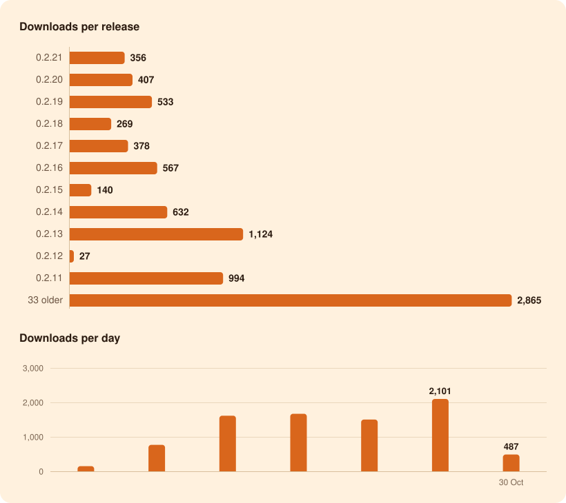

<h1 align="center">3,692 downloads</h1>

of Oyenza Studio for Windows, from GitHub since 24 Oct 2026 Latest release, 0.2.13: <b>25</b> · Last 7 days: <b>3,692</b> · <b>99</b> stars on GitHub

## Per release

| Release | Published | Download button | Versioned installer | Portable zip | Other files | Total |
| --- | --- | --: | --: | --: | --: | --: |
| [0.2.13](https://github.com/lucacadalora/oyenza-studio/releases/tag/v0.2.13) | 27 Oct 2026 | 12 | 11 | 0 | 2 | 25 |
| [0.2.12](https://github.com/lucacadalora/oyenza-studio/releases/tag/v0.2.12) | 27 Oct 2026 | 9 | 13 | 0 | 0 | 22 |
| [0.2.11](https://github.com/lucacadalora/oyenza-studio/releases/tag/v0.2.11) | 26 Oct 2026 | 467 | 402 | 4 | 114 | 987 |
| [0.2.10](https://github.com/lucacadalora/oyenza-studio/releases/tag/v0.2.10) | 26 Oct 2026 | 32 | 49 | 0 | 13 | 94 |
| [0.2.9](https://github.com/lucacadalora/oyenza-studio/releases/tag/v0.2.9) | 26 Oct 2026 | 33 | 20 | 1 | 5 | 59 |
| [0.2.8](https://github.com/lucacadalora/oyenza-studio/releases/tag/v0.2.8) | 26 Oct 2026 | 284 | 83 | 10 | 69 | 446 |
| [0.2.7](https://github.com/lucacadalora/oyenza-studio/releases/tag/v0.2.7) | 26 Oct 2026 | 41 | 13 | 0 | 8 | 62 |
| [0.2.6](https://github.com/lucacadalora/oyenza-studio/releases/tag/v0.2.6) | 25 Oct 2026 | 743 | 31 | 15 | 139 | 928 |
| [0.2.5](https://github.com/lucacadalora/oyenza-studio/releases/tag/v0.2.5) | 25 Oct 2026 | 18 | 2 | 2 | 2 | 24 |
| [0.2.4](https://github.com/lucacadalora/oyenza-studio/releases/tag/v0.2.4) | 25 Oct 2026 | 140 | 9 | 5 | 21 | 175 |
| [0.2.3](https://github.com/lucacadalora/oyenza-studio/releases/tag/v0.2.3) | 25 Oct 2026 | 55 | 19 | 1 | 17 | 92 |
| [0.2.2](https://github.com/lucacadalora/oyenza-studio/releases/tag/v0.2.2) | 25 Oct 2026 | 81 | 7 | 2 | 11 | 101 |
| [0.2.1](https://github.com/lucacadalora/oyenza-studio/releases/tag/v0.2.1) | 25 Oct 2026 | 8 | 0 | 0 | 3 | 11 |
| [0.2.0](https://github.com/lucacadalora/oyenza-studio/releases/tag/v0.2.0) | 25 Oct 2026 | 44 | 6 | 2 | 9 | 61 |
| [0.1.21](https://github.com/lucacadalora/oyenza-studio/releases/tag/v0.1.21) | 25 Oct 2026 | 7 | 3 | 0 | 2 | 12 |
| [0.1.20](https://github.com/lucacadalora/oyenza-studio/releases/tag/v0.1.20) | 24 Oct 2026 | 18 | 3 | 0 | 4 | 25 |
| [0.1.19](https://github.com/lucacadalora/oyenza-studio/releases/tag/v0.1.19) | 24 Oct 2026 | 4 | 1 | 0 | 2 | 7 |
| [0.1.18](https://github.com/lucacadalora/oyenza-studio/releases/tag/v0.1.18) | 24 Oct 2026 | 4 | 2 | 1 | 0 | 7 |
| [0.1.17](https://github.com/lucacadalora/oyenza-studio/releases/tag/v0.1.17) | 24 Oct 2026 | 92 | 221 | 43 | 27 | 383 |
| [0.1.16](https://github.com/lucacadalora/oyenza-studio/releases/tag/v0.1.16) | 24 Oct 2026 | 1 | 2 | 0 | 1 | 4 |
| [0.1.15](https://github.com/lucacadalora/oyenza-studio/releases/tag/v0.1.15) | 24 Oct 2026 | 2 | 1 | 0 | 1 | 4 |
| [0.1.14](https://github.com/lucacadalora/oyenza-studio/releases/tag/v0.1.14) | 24 Oct 2026 | 14 | 4 | 4 | — | 22 |
| [0.1.13](https://github.com/lucacadalora/oyenza-studio/releases/tag/v0.1.13) | 24 Oct 2026 | 7 | 1 | 1 | — | 9 |
| [0.1.12](https://github.com/lucacadalora/oyenza-studio/releases/tag/v0.1.12) | 24 Oct 2026 | 12 | 2 | 2 | — | 16 |
| [0.1.11](https://github.com/lucacadalora/oyenza-studio/releases/tag/v0.1.11) | 24 Oct 2026 | 2 | 1 | 3 | — | 6 |
| [0.1.10](https://github.com/lucacadalora/oyenza-studio/releases/tag/v0.1.10) | 24 Oct 2026 | 1 | 1 | 0 | — | 2 |
| [0.1.9](https://github.com/lucacadalora/oyenza-studio/releases/tag/v0.1.9) | 24 Oct 2026 | 4 | 5 | 3 | — | 12 |
| [0.1.8](https://github.com/lucacadalora/oyenza-studio/releases/tag/v0.1.8) | 24 Oct 2026 | 3 | 0 | 3 | — | 6 |
| [0.1.7](https://github.com/lucacadalora/oyenza-studio/releases/tag/v0.1.7) | 24 Oct 2026 | 2 | 1 | 0 | — | 3 |
| [0.1.6](https://github.com/lucacadalora/oyenza-studio/releases/tag/v0.1.6) | 24 Oct 2026 | 5 | 1 | 2 | — | 8 |
| [0.1.5](https://github.com/lucacadalora/oyenza-studio/releases/tag/v0.1.5) | 24 Oct 2026 | 6 | 3 | 1 | — | 10 |
| [0.1.4](https://github.com/lucacadalora/oyenza-studio/releases/tag/v0.1.4) | 24 Oct 2026 | 1 | 2 | 0 | — | 3 |
| [0.1.3](https://github.com/lucacadalora/oyenza-studio/releases/tag/v0.1.3) | 24 Oct 2026 | 2 | 1 | 0 | — | 3 |
| [0.1.2](https://github.com/lucacadalora/oyenza-studio/releases/tag/v0.1.2) | 24 Oct 2026 | 1 | 3 | 0 | — | 4 |
| [0.1.1](https://github.com/lucacadalora/oyenza-studio/releases/tag/v0.1.1) | 24 Oct 2026 | — | 57 | 0 | — | 57 |
| [0.1.0](https://github.com/lucacadalora/oyenza-studio/releases/tag/v0.1.0) | 24 Oct 2026 | — | 1 | 1 | — | 2 |
| **All releases** | | **2,155** | **981** | **106** | **450** | **3,692** |

## Per day

| Day | Downloads |
| --- | --: |
| Today | 1,161 |
| 26 Oct 2026 | 1,614 |
| 25 Oct 2026 | 767 |
| 24 Oct 2026 | 150 |

## On GitHub

99 stars · 16 forks · 0 watching

How we count

- GitHub counts every download of a release file. The Download button on the [website](https://studio.oyenza.com/) and in the README always fetches `Oyenza-Studio-Setup.exe` from the newest release; the versioned installer and the portable zip are on each release's page.
- Our CI downloads Poni-Setup-0.1.1.exe (0.1.1) while it tests each push, and GitHub counts those too: 458 so far, left out of every number here ([ci-downloads.csv](data/ci-downloads.csv) lists each one). GitHub's own counters add up to 4,150.
- GitHub updates its counters every few minutes, so for a while a counter may not show a CI download that is already taken off. Each file's number keeps its highest reading, so numbers only go up.
- Still in the numbers: our own check of each new release (one download through the Download button) and any bots. GitHub can't tell those apart.
- Oyenza Studio itself sends nothing: no accounts, no tracking. These are GitHub's download counters, read every hour.
- GitHub keeps no dates for downloads, so everything before the first reading counts on 24 Oct 2026.
- Page views and clones need a `METRICS_TOKEN` repository secret: a fine-grained token for this repository with Administration: Read-only. GitHub keeps them for 14 days only.

Updated 27 Oct 2026, 11:04 UTC by [Download stats](https://github.com/lucacadalora/oyenza-studio/actions/workflows/metrics.yml), every hour · Data: [downloads](data/downloads.csv), [CI downloads](data/ci-downloads.csv), [stars](data/repo.csv), [summary.json](summary.json)
