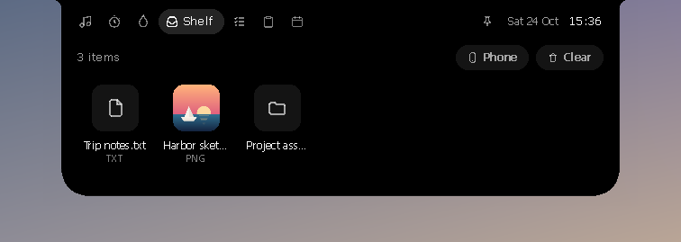

<p align="center"></p>

<h1 align="center">Oyen Poni</h1>

<p align="center"><b>A living notch for Windows 10 and 11.</b><br>Music with synced lyrics, a focus timer, your steps, a file shelf, tasks and your clipboard, one hover away.</p>

<p align="center">
  <a href="https://github.com/lucacadalora/poni/releases/latest/download/Oyen-Poni-Setup.exe"><b>Download for Windows</b></a>
  &nbsp;·&nbsp;
  <a href="https://lucacadalora.github.io/poni/"><b>Website</b></a>
  &nbsp;·&nbsp;
  <a href="#install">Install notes</a>
</p>

<p align="center"><a href="https://github.com/lucacadalora/poni/blob/metrics/README.md"></a></p>

<p align="center"></p>

A small black island hangs from the top of your screen. It shows what's happening (music, timers, volume, headphones connecting), and when you point at it, it opens into a set of quick pages.

Native Rust, no web view, no runtime, around 1.7 MB, and **zero CPU while nothing is moving**. It draws on the GPU, in step with your display's refresh rate (60, 144 or 240 Hz). No accounts, no tracking: your data stays on your PC.

| Collapsed | |
|---|---|
|  |  |
|  |  |
|  | |

## What it does

**While collapsed, the island shows live activities:**
- Album art and an equalizer while music plays. The title peeks for a moment when the song changes.
- A focus-timer countdown.
- Pop-ups for volume, charging and Bluetooth headsets, with battery level.
- Signed in to [Oyenza](#oyenza-optional), a notice when money arrives and a reminder the day before a bill is due.
- Once Oyenza can send the steps from your phone (coming soon), a notice when they reach the daily goal.

**Point at the island (or click it) to open it.** Scroll over the header to switch pages.

<table>
<tr><td width="84" align="center"></td><td><b>Music</b><br>Controls for whatever is playing (Spotify, Apple Music, YouTube in your browser, any app in Windows' media controls), with time-synced lyrics from <a href="https://lrclib.net">LRCLIB</a>, or Apple Music's own lyrics if you add <a href="#apple-music-lyrics">your Apple Music token</a></td></tr>
<tr><td width="84" align="center"></td><td><b>Focus</b><br>A Pomodoro timer that keeps counting in the island</td></tr>
<tr><td width="84" align="center"></td><td><b>Health</b><br>Today's steps against your goal, distance, active energy and your week, from Apple Health or Health Connect on your phone through your Oyenza account (coming soon)</td></tr>
<tr><td width="84" align="center"></td><td><b>Shelf</b><br>Drop files on the island to keep them handy; click to open or drag them back out. <a href="#phone-drop">Phone drop</a> brings files over from your phone and sends Shelf files to it</td></tr>
<tr><td width="84" align="center"></td><td><b>Tasks</b><br>A tiny to-do list</td></tr>
<tr><td width="84" align="center"></td><td><b>Clipboard</b><br>Recent copied text, kept in memory only. It skips anything password managers mark as private.</td></tr>
<tr><td width="84" align="center"></td><td><b>Today</b><br>Date and calendar, plus CPU, memory, disk and battery</td></tr>
</table>

| | |
|---|---|
|  |  |
|  |  |
|  |  |

### The Oyen theme

The island stays black by default. Switch on the Oyen theme (the gear › **Theme › Oyen**, or right-click › **Theme › Oyen**) and the whole island becomes Oyen's: warm cream with dark brown text, his orange on the play button, the bars and the switches, and Outfit, the Oyen Poni typeface. Oyen, the Oyenza cat, moves in too: he peeks over the island's edge while it rests, watches your pointer when it comes near, sits beside the clock, peeks up beside the pin when the island is open and bobs along while music plays. He sleeps from midnight to five. He is drawn from the Oyenza logo, not a picture, so he stays sharp at any scaling, and he only moves for a moment now and then, so the app still uses no CPU at rest.


The gear at the top right of the open island opens **Settings**: your Oyenza account first, then the theme, the idle look and the switches below. Right-click the island or the tray icon for every option:
- the theme: Classic or Oyen
- the idle look: clock, eyes (Oyen in his theme), minimal, or hidden until you hover
- lyrics (and the pronunciation line under Japanese, Korean and Chinese lyrics), clipboard history and sounds
- hide in full-screen apps
- start with Windows, and quit

## Install


**[Download Oyen-Poni-Setup.exe](https://github.com/lucacadalora/poni/releases/latest/download/Oyen-Poni-Setup.exe)** and run it. It installs just for you and needs no admin rights. Older versions and a portable zip are on the [Releases](https://github.com/lucacadalora/poni/releases) page.

Builds aren't code-signed yet, so Windows SmartScreen may say "Windows protected your PC". Click **More info → Run anyway**.

Your data lives in `%APPDATA%\Poni\`, and cache plus log in `%LOCALAPPDATA%\Poni\`. Uninstalling removes the app, cache and log, and keeps your data.

## Apple Music lyrics

Lyrics come from LRCLIB by default. With an Apple Music subscription, Oyen Poni can show Apple Music's own synced lyrics instead: the ones the Apple Music app shows. This works whichever app is playing. LRCLIB stays the backup for songs Apple has no synced lyrics for.

It needs your Apple Music token, copied once from the web player:

1. Open [music.apple.com](https://music.apple.com) in Chrome or Edge and sign in.
2. Press F12, open **Application** → **Cookies** → `https://music.apple.com`, and copy the value of `media-user-token`.
3. Right-click the island (or the tray icon) → **Apple Music lyrics** → **Use token from clipboard**.

Oyen Poni checks the token with Apple and says whether it worked. It stores the token encrypted for your Windows account (`%LOCALAPPDATA%\Poni\apple-music-token.bin`) and clears it from the clipboard. If Windows clipboard history (Win+V) is on, delete it there too. A token lasts for months; when Apple stops accepting it, Oyen Poni says so and you copy a fresh one. **Remove token** in the same menu turns this off.

With a token saved, Oyen Poni sends each song's title and artist to Apple to find its lyrics. It uses the Apple Music web player's own API, which Apple doesn't publish for other apps, so it can stop working when Apple changes its site. LRCLIB keeps working either way.

## Phone drop

Send photos and files from your phone to the Shelf, or save Shelf files on your phone, over your own Wi-Fi. Nothing to install on the phone, and it works with iPhones and Android phones alike.

1. Open the Shelf and click **Phone** (on an empty shelf, the **Phone drop** tile). A QR code opens under the shelf.
2. Scan it with the phone's camera. The phone opens a small page that Oyen Poni serves from your PC.
3. Pick photos or files on the phone and tap **Send**. The island asks first: **Accept** or **Decline**. Accepted files go to `Downloads\Oyen Poni` and onto the Shelf.
4. The page also lists the files on the Shelf. Tap **Save** to keep one on the phone.

| | |
|---|---|
|  |  |

The phone and the PC need the same Wi-Fi; guest networks often keep devices apart. The first time, Windows asks whether Oyen Poni may use the network: allow it on private networks. If Windows treats your Wi-Fi as a public network, set it to private (Settings > Network & internet > Wi-Fi), or the phone can't reach the PC.

Each session gets a new secret link that only the QR code carries. It stops working when you click **Done**, and after 10 minutes without a phone. Oyen Poni reads nothing from an upload before you accept, keeps a transfer only when every file arrived, and never sends anything through the internet. Files travel over your Wi-Fi without extra encryption on top of the Wi-Fi's own, so use Phone drop on networks you trust rather than public hotspots.

This isn't AirDrop. An iPhone only AirDrops over Apple's own Wi-Fi link (AWDL), which Windows Wi-Fi drivers can't run, so Phone drop uses the phone's browser instead.

## Oyenza (optional)

If you keep your money in [Oyenza](https://oyenza.app), the island can show it. Signing in is optional and works like a TV: no password is typed into Oyen Poni.

1. Open the island, press the gear at the top right, and choose **Sign in with Oyenza** (the Health page has the same button; right-click the island or the tray icon → **Oyenza** → **Sign in to Oyenza…** works too). The island shows an 8-letter code.
2. Open oyenza.app/connect on your phone or this PC (**Open oyenza.app** fills the code in), check the PC's name, and choose **Connect**.

Then the island shows:

- **Money as it arrives**: money Oyenza logged by itself from your bank's emails or notifications. The sum and sender stay hidden until you click **Show**, so a shared screen shows only "Money in · BCA".
- **Bills before they're due**: a reminder the day before a subscription renews or a card bill is due.
- **Note a spend**: type it in the **Oyenza** tab ("kopi 25rb") and press Enter; it goes straight to Oyenza, with Undo for 10 seconds.

This PC gets a key of its own that can do only these things: it can't read your history, change or delete anything else, or touch your account. It is stored encrypted for your Windows account (`%LOCALAPPDATA%\Poni\oyenza-link.bin`). Oyen Poni asks Oyenza once a minute while you use the PC (every 3 minutes on battery, never while it's locked or asleep). **Disconnect** in Settings (or **Oyenza › Disconnect** in the menu) signs this PC out; you can also disconnect it in oyenza.app under Connected apps.

## Build

Oyen Poni is a Cargo workspace:

| Crate | What |
|---|---|
| `crates/poni-core` | Pure logic (springs, lyrics parsing, Pomodoro, steps, tasks, settings…) and Phone drop's small web server. Unit-tested on any OS. |
| `crates/poni` | The Windows app: Win32 + Direct2D + WinRT through [windows-rs](https://github.com/microsoft/windows-rs). |

On Windows, with Rust stable and the MSVC toolchain:

```
cargo test -p poni-core
cargo build -p poni --release        # target\release\poni.exe
```

To cross-build from macOS or Linux, install `mingw-w64` and add the target (`rustup target add x86_64-pc-windows-gnu`):

```
cargo wcheck                          # type-check the Windows app
cargo wbuild                          # target/x86_64-pc-windows-gnu/release/poni.exe
NSIS_HOST=user@linux-box tools/package.sh   # exe + portable zip + installer into dist/
```

### Testing without clicking around

`poni.exe --selftest <dir>` runs a scripted tour of every state with fake data and writes a screenshot of each one, plus `report.json` with layout and timing checks. The exit code is non-zero on failure. It also works under Wine on Linux (`tools/run-selftest-wine.sh`), which is how the screenshots above were made, so the font is a stand-in for Segoe UI.

| Variable | Effect |
|---|---|
| `PONI_SELFTEST_DPI=144` | Render at 150% scaling (also 120 and 192) |
| `PONI_SELFTEST_ANIM=1` | Also record the transitions frame by frame (plus each frame's screen position in `anim-<name>.json`) |
| `PONI_RENDERER=software` | Draw in software instead of on the GPU (also outside the self-test, for troubleshooting) |


See [ARCHITECTURE.md](ARCHITECTURE.md) for how the pieces fit: threads, the rendering model, the page and service contracts, and data files.

### Website

The website is `site/index.html`, published with GitHub Pages by `.github/workflows/pages.yml` whenever `site/` or `docs/brand/` changes on main. Preview it with `tools/build_site.sh && python3 -m http.server -d _site 8000`. Its island screenshots come from the self-test at 200 % in both themes (`tools/site_shots.py`).

### Download stats

[The stats page](https://github.com/lucacadalora/poni/blob/metrics/README.md) shows downloads per release and per day. Every hour `.github/workflows/metrics.yml` reads GitHub's download counters with `tools/download_metrics.py` and keeps the history on the `metrics` branch. Downloads made by our own CI (the install test fetches the 0.1.1 installer on every push) are left out. The app itself counts nothing.

## Status

Early, but in daily use on Windows 11. Most rough edges are in places a test machine can't fully exercise: specific media players, Bluetooth devices, and multi-monitor setups. Issues and pull requests are welcome. Please attach `%LOCALAPPDATA%\Poni\poni.log` when something misbehaves.

## Credits

- Synced lyrics come from [LRCLIB](https://lrclib.net), a free and open lyrics database. Oyen Poni fetches them only while a song plays and caches them on your PC.
- With your token, lyrics can also come from [Apple Music](https://music.apple.com) (see [Apple Music lyrics](#apple-music-lyrics)).
- Phone drop follows the design of [Windfall](https://github.com/UvejsGj/Windfall)'s phone page (MIT). QR codes come from [qrcodegen](https://github.com/nayuki/QR-Code-generator) (MIT).
- Built with [windows-rs](https://github.com/microsoft/windows-rs) and [serde](https://serde.rs).

## License

The code is [MIT](LICENSE). The Oyen Poni name, its logo and the Oyen character (the files in `docs/brand`, `installer/art` and the app icon) are not covered by the MIT license, so please don't reuse them in other projects.
