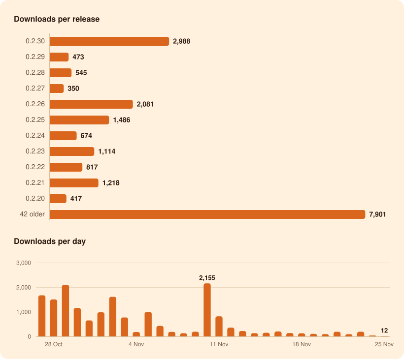

<h1 align="center">19,749 downloads</h1>

of Oyenza Studio for Windows, from GitHub since 24 Oct 2026 Latest release, 0.2.30: <b>2,814</b> · Last 7 days: <b>857</b> · <b>177</b> stars on GitHub

## Per release

| Release | Published | Download button | Versioned installer | Portable zip | Other files | Total |
| --- | --- | --: | --: | --: | --: | --: |
| [0.2.30](https://github.com/lucacadalora/oyenza-studio/releases/tag/v0.2.30) | 10 Nov 2026 | 710 | 1,362 | 341 | 401 | 2,814 |
| [0.2.29](https://github.com/lucacadalora/oyenza-studio/releases/tag/v0.2.29) | 10 Nov 2026 | 23 | 349 | 1 | 96 | 469 |
| [0.2.28](https://github.com/lucacadalora/oyenza-studio/releases/tag/v0.2.28) | 10 Nov 2026 | 44 | 388 | 2 | 108 | 542 |
| [0.2.27](https://github.com/lucacadalora/oyenza-studio/releases/tag/v0.2.27) | 10 Nov 2026 | 21 | 252 | 1 | 73 | 347 |
| [0.2.26](https://github.com/lucacadalora/oyenza-studio/releases/tag/v0.2.26) | 5 Nov 2026 | 417 | 1,089 | 307 | 265 | 2,078 |
| [0.2.25](https://github.com/lucacadalora/oyenza-studio/releases/tag/v0.2.25) | 2 Nov 2026 | 227 | 1,052 | 36 | 168 | 1,483 |
| [0.2.24](https://github.com/lucacadalora/oyenza-studio/releases/tag/v0.2.24) | 2 Nov 2026 | 45 | 526 | 4 | 96 | 671 |
| [0.2.23](https://github.com/lucacadalora/oyenza-studio/releases/tag/v0.2.23) | 1 Nov 2026 | 94 | 879 | 34 | 104 | 1,111 |
| [0.2.22](https://github.com/lucacadalora/oyenza-studio/releases/tag/v0.2.22) | 31 Oct 2026 | 90 | 617 | 16 | 91 | 814 |
| [0.2.21](https://github.com/lucacadalora/oyenza-studio/releases/tag/v0.2.21) | 30 Oct 2026 | 231 | 849 | 8 | 127 | 1,215 |
| [0.2.20](https://github.com/lucacadalora/oyenza-studio/releases/tag/v0.2.20) | 29 Oct 2026 | 34 | 334 | 5 | 41 | 414 |
| [0.2.19](https://github.com/lucacadalora/oyenza-studio/releases/tag/v0.2.19) | 29 Oct 2026 | 46 | 423 | 6 | 62 | 537 |
| [0.2.18](https://github.com/lucacadalora/oyenza-studio/releases/tag/v0.2.18) | 29 Oct 2026 | 19 | 210 | 3 | 41 | 273 |
| [0.2.17](https://github.com/lucacadalora/oyenza-studio/releases/tag/v0.2.17) | 29 Oct 2026 | 45 | 283 | 6 | 49 | 383 |
| [0.2.16](https://github.com/lucacadalora/oyenza-studio/releases/tag/v0.2.16) | 28 Oct 2026 | 41 | 459 | 3 | 65 | 568 |
| [0.2.15](https://github.com/lucacadalora/oyenza-studio/releases/tag/v0.2.15) | 28 Oct 2026 | 6 | 121 | 4 | 12 | 143 |
| [0.2.14](https://github.com/lucacadalora/oyenza-studio/releases/tag/v0.2.14) | 28 Oct 2026 | 106 | 462 | 4 | 65 | 637 |
| [0.2.13](https://github.com/lucacadalora/oyenza-studio/releases/tag/v0.2.13) | 27 Oct 2026 | 303 | 695 | 9 | 121 | 1,128 |
| [0.2.12](https://github.com/lucacadalora/oyenza-studio/releases/tag/v0.2.12) | 27 Oct 2026 | 11 | 15 | 3 | 1 | 30 |
| [0.2.11](https://github.com/lucacadalora/oyenza-studio/releases/tag/v0.2.11) | 26 Oct 2026 | 469 | 405 | 7 | 117 | 998 |
| [0.2.10](https://github.com/lucacadalora/oyenza-studio/releases/tag/v0.2.10) | 26 Oct 2026 | 35 | 50 | 3 | 14 | 102 |
| [0.2.9](https://github.com/lucacadalora/oyenza-studio/releases/tag/v0.2.9) | 26 Oct 2026 | 36 | 21 | 5 | 6 | 68 |
| [0.2.8](https://github.com/lucacadalora/oyenza-studio/releases/tag/v0.2.8) | 26 Oct 2026 | 286 | 87 | 14 | 71 | 458 |
| [0.2.7](https://github.com/lucacadalora/oyenza-studio/releases/tag/v0.2.7) | 26 Oct 2026 | 44 | 15 | 3 | 9 | 71 |
| [0.2.6](https://github.com/lucacadalora/oyenza-studio/releases/tag/v0.2.6) | 25 Oct 2026 | 746 | 32 | 18 | 141 | 937 |
| [0.2.5](https://github.com/lucacadalora/oyenza-studio/releases/tag/v0.2.5) | 25 Oct 2026 | 21 | 3 | 5 | 3 | 32 |
| [0.2.4](https://github.com/lucacadalora/oyenza-studio/releases/tag/v0.2.4) | 25 Oct 2026 | 143 | 10 | 9 | 22 | 184 |
| [0.2.3](https://github.com/lucacadalora/oyenza-studio/releases/tag/v0.2.3) | 25 Oct 2026 | 58 | 25 | 4 | 19 | 106 |
| [0.2.2](https://github.com/lucacadalora/oyenza-studio/releases/tag/v0.2.2) | 25 Oct 2026 | 84 | 8 | 5 | 13 | 110 |
| [0.2.1](https://github.com/lucacadalora/oyenza-studio/releases/tag/v0.2.1) | 25 Oct 2026 | 11 | 1 | 3 | 4 | 19 |
| [0.2.0](https://github.com/lucacadalora/oyenza-studio/releases/tag/v0.2.0) | 25 Oct 2026 | 46 | 8 | 5 | 10 | 69 |
| [0.1.21](https://github.com/lucacadalora/oyenza-studio/releases/tag/v0.1.21) | 25 Oct 2026 | 9 | 4 | 3 | 3 | 19 |
| [0.1.20](https://github.com/lucacadalora/oyenza-studio/releases/tag/v0.1.20) | 24 Oct 2026 | 19 | 5 | 4 | 5 | 33 |
| [0.1.19](https://github.com/lucacadalora/oyenza-studio/releases/tag/v0.1.19) | 24 Oct 2026 | 5 | 3 | 2 | 3 | 13 |
| [0.1.18](https://github.com/lucacadalora/oyenza-studio/releases/tag/v0.1.18) | 24 Oct 2026 | 5 | 4 | 3 | 1 | 13 |
| [0.1.17](https://github.com/lucacadalora/oyenza-studio/releases/tag/v0.1.17) | 24 Oct 2026 | 98 | 238 | 51 | 35 | 422 |
| [0.1.16](https://github.com/lucacadalora/oyenza-studio/releases/tag/v0.1.16) | 24 Oct 2026 | 3 | 3 | 2 | 2 | 10 |
| [0.1.15](https://github.com/lucacadalora/oyenza-studio/releases/tag/v0.1.15) | 24 Oct 2026 | 4 | 2 | 2 | 2 | 10 |
| [0.1.14](https://github.com/lucacadalora/oyenza-studio/releases/tag/v0.1.14) | 24 Oct 2026 | 15 | 6 | 6 | — | 27 |
| [0.1.13](https://github.com/lucacadalora/oyenza-studio/releases/tag/v0.1.13) | 24 Oct 2026 | 8 | 3 | 2 | — | 13 |
| [0.1.12](https://github.com/lucacadalora/oyenza-studio/releases/tag/v0.1.12) | 24 Oct 2026 | 13 | 4 | 3 | — | 20 |
| [0.1.11](https://github.com/lucacadalora/oyenza-studio/releases/tag/v0.1.11) | 24 Oct 2026 | 3 | 3 | 5 | — | 11 |
| [0.1.10](https://github.com/lucacadalora/oyenza-studio/releases/tag/v0.1.10) | 24 Oct 2026 | 2 | 3 | 2 | — | 7 |
| [0.1.9](https://github.com/lucacadalora/oyenza-studio/releases/tag/v0.1.9) | 24 Oct 2026 | 5 | 7 | 5 | — | 17 |
| [0.1.8](https://github.com/lucacadalora/oyenza-studio/releases/tag/v0.1.8) | 24 Oct 2026 | 4 | 2 | 5 | — | 11 |
| [0.1.7](https://github.com/lucacadalora/oyenza-studio/releases/tag/v0.1.7) | 24 Oct 2026 | 4 | 2 | 2 | — | 8 |
| [0.1.6](https://github.com/lucacadalora/oyenza-studio/releases/tag/v0.1.6) | 24 Oct 2026 | 6 | 3 | 4 | — | 13 |
| [0.1.5](https://github.com/lucacadalora/oyenza-studio/releases/tag/v0.1.5) | 24 Oct 2026 | 8 | 4 | 3 | — | 15 |
| [0.1.4](https://github.com/lucacadalora/oyenza-studio/releases/tag/v0.1.4) | 24 Oct 2026 | 2 | 4 | 2 | — | 8 |
| [0.1.3](https://github.com/lucacadalora/oyenza-studio/releases/tag/v0.1.3) | 24 Oct 2026 | 4 | 3 | 2 | — | 9 |
| [0.1.2](https://github.com/lucacadalora/oyenza-studio/releases/tag/v0.1.2) | 24 Oct 2026 | 2 | 5 | 2 | — | 9 |
| [0.1.1](https://github.com/lucacadalora/oyenza-studio/releases/tag/v0.1.1) | 24 Oct 2026 | — | 242 | 2 | — | 244 |
| [0.1.0](https://github.com/lucacadalora/oyenza-studio/releases/tag/v0.1.0) | 24 Oct 2026 | — | 3 | 3 | — | 6 |
| **All releases** | | **4,711** | **11,583** | **989** | **2,466** | **19,749** |

## Per day

| Day | Downloads |
| --- | --: |
| Today | 12 |
| 21 Nov 2026 | 187 |
| 20 Nov 2026 | 92 |
| 19 Nov 2026 | 105 |
| 18 Nov 2026 | 125 |
| 17 Nov 2026 | 137 |
| 16 Nov 2026 | 199 |
| 15 Nov 2026 | 147 |
| 14 Nov 2026 | 131 |
| 13 Nov 2026 | 220 |
| 12 Nov 2026 | 355 |
| 11 Nov 2026 | 815 |
| 10 Nov 2026 | 2,155 |
| 9 Nov 2026 | 189 |
| 8 Nov 2026 | 126 |
| 7 Nov 2026 | 184 |
| 6 Nov 2026 | 428 |
| 5 Nov 2026 | 992 |
| 4 Nov 2026 | 181 |
| 3 Nov 2026 | 769 |
| 2 Nov 2026 | 1,607 |
| 1 Nov 2026 | 980 |
| 31 Oct 2026 | 650 |
| 30 Oct 2026 | 1,158 |
| 29 Oct 2026 | 2,101 |
| 28 Oct 2026 | 1,502 |
| 27 Oct 2026 | 1,671 |
| 26 Oct 2026 | 1,614 |
| 25 Oct 2026 | 767 |
| 24 Oct 2026 | 150 |

## On GitHub

177 stars · 45 forks · 0 watching

How we count

- GitHub counts every download of a release file. The Download button on the [website](https://studio.oyenza.com/) and in the README always fetches `Oyenza-Studio-Setup.exe` from the newest release; the versioned installer and the portable zip are on each release's page.
- Our CI downloads Poni-Setup-0.1.1.exe (0.1.1) while it tests each push, and GitHub counts those too: 689 so far, left out of every number here ([ci-downloads.csv](data/ci-downloads.csv) lists each one). GitHub's own counters add up to 20,061.
- GitHub updates its counters every few minutes, so for a while a counter may not show a CI download that is already taken off. Each file's number keeps its highest reading, so numbers only go up.
- Still in the numbers: our own check of each new release (one download through the Download button) and any bots. GitHub can't tell those apart.
- Oyenza Studio itself sends nothing: no accounts, no tracking. These are GitHub's download counters, read every hour.
- GitHub keeps no dates for downloads, so everything before the first reading counts on 24 Oct 2026.
- Page views and clones need a `METRICS_TOKEN` repository secret: a fine-grained token for this repository with Administration: Read-only. GitHub keeps them for 14 days only.

Updated 22 Nov 2026, 02:40 UTC by [Download stats](https://github.com/lucacadalora/oyenza-studio/actions/workflows/metrics.yml), every hour · Data: [downloads](data/downloads.csv), [CI downloads](data/ci-downloads.csv), [stars](data/repo.csv), [summary.json](summary.json)
