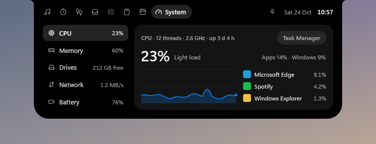
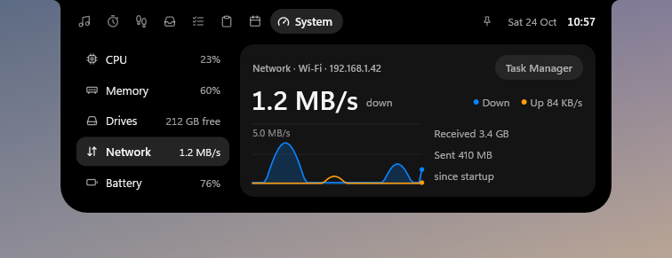
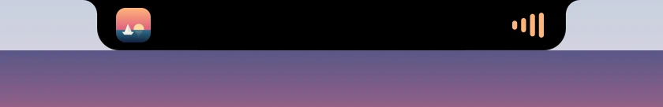
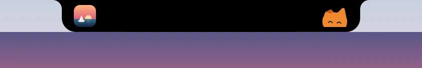
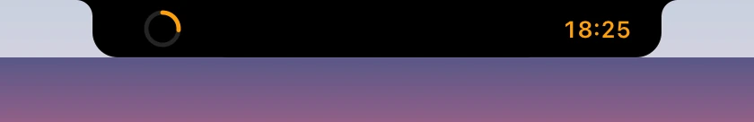
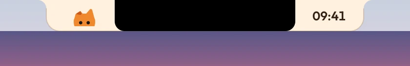
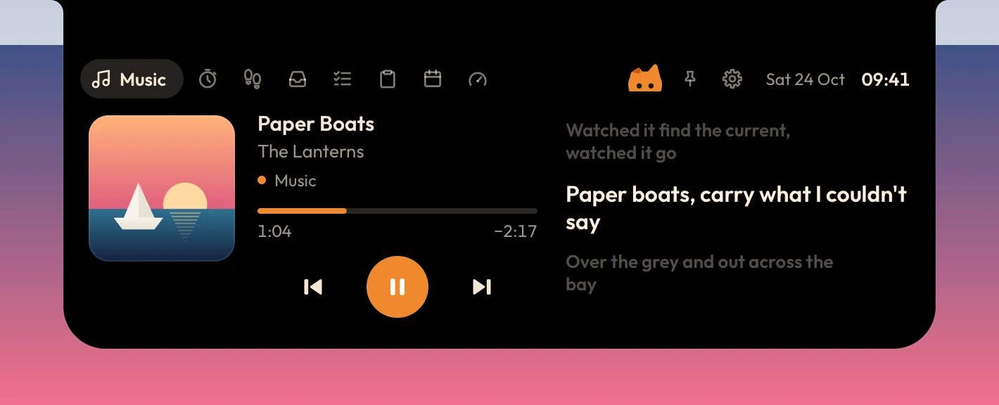

<p align="center"></p>

<h1 align="center">Oyen Poni</h1>

<p align="center"><b>A living notch for Windows and Mac.</b><br>Music with synced lyrics, a focus timer, a file shelf, tasks and your clipboard, one hover away.<br>Windows 10 and 11 · macOS 14 or later</p>

<p align="center">
  <a href="https://github.com/lucacadalora/poni/releases/latest/download/Oyen-Poni-Setup.exe"></a>
  &nbsp;
  <a href="https://github.com/lucacadalora/poni/releases/latest/download/Oyen-Poni-Mac.dmg"></a>
</p>

<p align="center">
  <a href="https://lucacadalora.github.io/poni/"><b>Website</b></a>
  &nbsp;·&nbsp;
  <a href="#install">Install notes</a>
</p>

<p align="center"><a href="https://github.com/lucacadalora/poni/blob/metrics/README.md"></a></p>

<p align="center"></p>

A small black island hangs from the top of your screen. It shows what's happening (music, timers, volume, headphones connecting), and when you point at it, it opens into a set of quick pages. On a MacBook it wraps the camera notch ([On a Mac](#on-a-mac)).

Native Rust, no web view, no runtime, around 1.7 MB, and **zero CPU while nothing is moving**. It draws on the GPU, in step with your display's refresh rate (60, 144 or 240 Hz). No accounts, no tracking: your data stays on your computer.

| Collapsed | |
|---|---|
|  |  |
|  |  |
|  | |

## What it does

**While collapsed, the island shows live activities:**
- Album art and an equalizer while music plays. The title peeks for a moment when the song changes.
- A focus-timer countdown.
- Pop-ups for volume, charging and Bluetooth headsets, with battery level.
- Signed in to [Oyenza](#oyenza-optional), a notice when money comes in or goes out and a reminder the day before a bill is due.
- With the [Prayer times](#add-ons) add-on on, the minutes before each prayer and a notice when it's time.
- Once Oyenza can send the steps from your phone (coming soon), a notice when they reach the daily goal.

**Point at the island (or click it) to open it.** Scroll over the header to switch pages.

<table>
<tr><td width="84" align="center"></td><td><b>Music</b><br>Controls for whatever is playing (Spotify, Apple Music, YouTube in your browser, any app in Windows' media controls), with time-synced lyrics from <a href="https://lrclib.net">LRCLIB</a>, or Apple Music's own lyrics if you add <a href="#apple-music-lyrics">your Apple Music token</a></td></tr>
<tr><td width="84" align="center"></td><td><b>Focus</b><br>A Pomodoro timer that keeps counting in the island</td></tr>
<tr><td width="84" align="center"></td><td><b>Health</b><br>Today's steps against your goal, distance, active energy and your week, from Apple Health or Health Connect on your phone through your Oyenza account (coming soon)</td></tr>
<tr><td width="84" align="center"></td><td><b>Shelf</b><br>Drop files on the island to keep them handy; click to open or drag them back out. <a href="#phone-drop">Phone drop</a> brings files over from your phone and sends Shelf files to it</td></tr>
<tr><td width="84" align="center"></td><td><b>Tasks</b><br>A tiny to-do list</td></tr>
<tr><td width="84" align="center"></td><td><b>Clipboard</b><br>Recent copied text, kept in memory only. It skips anything password managers mark as private.</td></tr>
<tr><td width="84" align="center"></td><td><b>Today</b><br>Date and calendar, plus CPU, memory, disk and battery. Click a ring to open it on the System page</td></tr>
<tr><td width="84" align="center"></td><td><b>System</b><br>CPU, GPU, memory, drives, network and battery: rings and gauges, each core's load, the last minute of history and the processes using the most. Read straight from Windows' own kernel counters, without drivers or admin rights, and never leaves your PC. The minute keeps going while the page is closed (a light reading once a second; switch it off with right-click › Keep System page history)</td></tr>
<tr><td width="84" align="center"></td><td><b>Show over games</b><br>FPS, GPU load and temperature and CPU load on the island while a borderless full-screen game is in front. Switch it on in System › Games or right-click › In full-screen apps. See <a href="#show-over-games">Show over games</a></td></tr>
<tr><td width="84" align="center"></td><td><b>Prayer</b> (an <a href="#add-ons">add-on</a>)<br>Today's prayer times for your kab/kota from Kemenag RI, the next prayer and how long until it, and the qibla</td></tr>
</table>

| | |
|---|---|
|  |  |
|  |  |
|  |  |
|  |  |

### The Oyen theme

The island stays black by default. Switch on the Oyen theme (the gear › **Theme › Oyen**, or right-click › **Theme › Oyen**) and the whole island becomes Oyen's: warm cream with dark brown text, his orange on the play button, the bars and the switches, and Outfit, the Oyen Poni typeface. Oyen, the Oyenza cat, moves in too: he peeks over the island's edge while it rests, watches your pointer when it comes near, sits beside the clock, peeks up beside the pin when the island is open and bobs along while music plays. He sleeps from midnight to five. He is drawn from the Oyenza logo, not a picture, so he stays sharp at any scaling, and he only moves for a moment now and then, so he costs no CPU at rest.


### The Glass theme

Glass turns the island into liquid glass, after Apple's Liquid Glass. Its rim bends and magnifies what's under it, the middle is frosted, a light runs along the edge, and the shadow under it deepens over busy pages. The collapsed island turns light or dark with what's behind it, and the open island follows Windows' light or dark mode. Its tint goes only as deep as the text needs to stay readable (4.5:1).

To bend what's under it, Glass copies the part of the screen behind its window (the island and the space it opens into) whenever something there changes, and not while the island is hidden or the PC is locked. The copy stays in your PC's memory and on its graphics card, and each new copy replaces the last; it's never saved or sent. While Glass is on, Windows leaves Oyen Poni out of screenshots, screen recordings and screen sharing. On a display in HDR, Poni maps the copy back to ordinary colours itself. Where Poni can't copy the screen (the software renderer, Windows 10 before version 2004, Remote Desktop, a laptop display that no graphics card lets it copy), Glass draws smoked glass instead: the same shape, light and shadow over a see-through tint, and it stays in screenshots.

The gear at the top right of the open island opens **Settings**: your Oyenza account first, then the theme, the idle look and the switches below. Right-click the island or the tray icon for every option:
- the theme: Classic, Oyen or Glass
- the idle look: clock, eyes (Oyen in his theme), minimal, or hidden until you hover
- lyrics (and the pronunciation line under Japanese, Korean and Chinese lyrics), clipboard history and sounds
- in full-screen apps: hide, or stay on top of borderless games and videos (a game in exclusive full-screen mode still covers it), and show FPS, GPU and CPU over games
- start with Windows, and quit

### Show over games

Switch on **Show over games** (System › Games, or right-click › In full-screen apps) and, while a game fills the screen in borderless full-screen, the island becomes a small readout: frames per second, the GPU's load and temperature and the CPU's load, once a second. Hover it to open the island as usual. Turning it on also keeps the island on top of full-screen apps; picking Hide there turns it off again.

The frame rate is counted the way Intel's PresentMon and Xbox Game Bar count it: Windows logs every frame a game hands to the screen, and Oyen Poni reads that log for the game in front. Nothing is loaded into the game, so there is nothing for anti-cheat to see. DirectX 9 to 12 games are counted from their own Present calls; Vulkan and OpenGL games from the graphics kernel's log of their frames. The GPU and CPU numbers come from the same readers as the System page. Nothing runs while no game is in front or while the readout is off.

Windows lets only admins and the **Performance Log Users** group read that log. The first time, System › Games asks for a one-time OK: an admin prompt adds your Windows account to that group (Xbox Game Bar's FPS counter asks for the same), and Windows applies it the next time you sign in. Until then the FPS slot shows a dash and the rest works. To undo it, remove your account from Performance Log Users in Computer Management, or run `net localgroup "Performance Log Users" <your user name> /delete` as an admin. A game in exclusive full-screen mode still covers the island, as it covers every window.

## On a Mac

On a MacBook with a camera notch, the island lives around it: what's playing sits either side of the camera (the album art on the left and the beat on the right, a timer's ring and its minutes the same way), and the island opens downward from the notch when you point at it. On a Mac without a notch, or on another display, it hangs from the top of the screen as it does on Windows.

| | |
|---|---|
|  |  |
|  |  |



The Mac app has the island, Music and Spotify with synced lyrics (and Apple Music's own with [your token](#apple-music-lyrics)), the focus timer, the Shelf with [Phone drop](#phone-drop) over the same Wi-Fi, tasks, clipboard history, Today with your Mac's CPU, memory, disk and battery, pop-ups for volume and charging, the Classic and Oyen themes, and start at login. Every option is in the menu bar, under Oyen's mark. Not on the Mac yet: Glass, paired phones, Oyenza sign-in, add-ons, Show over games, headphone pop-ups and hiding in full-screen apps.

These pictures come from the Mac app itself (`poni --render <dir> --notch`, run by the `mac` workflow on a macOS runner with a MacBook's notch drawn in).

## Install


### On Windows

**[Download Oyen-Poni-Setup.exe](https://github.com/lucacadalora/poni/releases/latest/download/Oyen-Poni-Setup.exe)** and run it. It installs just for you and needs no admin rights. Older versions and a portable zip are on the [Releases](https://github.com/lucacadalora/poni/releases) page.

Builds aren't code-signed yet, so Windows SmartScreen may say "Windows protected your PC". Click **More info → Run anyway**.

Your data lives in `%APPDATA%\Poni\`, and cache plus log in `%LOCALAPPDATA%\Poni\`. Uninstalling removes the app, cache and log, and keeps your data.

### On a Mac

macOS 14 or later, Apple silicon or Intel (one app for both): **[download Oyen-Poni-Mac.dmg](https://github.com/lucacadalora/poni/releases/latest/download/Oyen-Poni-Mac.dmg)**, open it and drag Oyen Poni into Applications. It isn't signed with an Apple Developer ID yet, so the first time macOS warns you, click **Done**, then open **System Settings → Privacy & Security** and click **Open Anyway**. What's on the Mac so far: [On a Mac](#on-a-mac). Your data lives in `~/Library/Application Support/Poni/`, the log in `~/Library/Logs/Poni/`.

## Apple Music lyrics

Lyrics come from LRCLIB by default. With an Apple Music subscription, Oyen Poni can show Apple Music's own synced lyrics instead: the ones the Apple Music app shows. This works whichever app is playing. LRCLIB stays the backup for songs Apple has no synced lyrics for.

It needs your Apple Music token, copied once from the web player:

1. Open [music.apple.com](https://music.apple.com) in Chrome or Edge and sign in.
2. Press F12, open **Application** → **Cookies** → `https://music.apple.com`, and copy the value of `media-user-token`.
3. Right-click the island (or the tray icon) → **Apple Music lyrics** → **Use token from clipboard**.

Oyen Poni checks the token with Apple and says whether it worked. It stores the token encrypted for your Windows account (`%LOCALAPPDATA%\Poni\apple-music-token.bin`) and clears it from the clipboard. If Windows clipboard history (Win+V) is on, delete it there too. A token lasts for months; when Apple stops accepting it, Oyen Poni says so and you copy a fresh one. **Remove token** in the same menu turns this off.

With a token saved, Oyen Poni sends each song's title and artist to Apple to find its lyrics. It uses the Apple Music web player's own API, which Apple doesn't publish for other apps, so it can stop working when Apple changes its site. LRCLIB keeps working either way.

## Phone drop

Send photos and files from your phone to the Shelf, or save Shelf files on your phone, over your own Wi-Fi. Nothing to install on the phone, and it works with iPhones and Android phones alike.

1. Open the Shelf and click **Phone** (on an empty shelf, the **Phone drop** tile). A QR code opens under the shelf.
2. Scan it with the phone's camera. The phone opens a small page that Oyen Poni serves from your PC.
3. Pick photos or files on the phone and tap **Send**. The island asks first: **Accept** or **Decline**. Accepted files go to `Downloads\Oyen Poni` and onto the Shelf.
4. The page also lists the files on the Shelf. Tap **Save** to keep one on the phone.

| | |
|---|---|
|  |  |

The phone and the PC need the same Wi-Fi; guest networks often keep devices apart. The first time, Windows asks whether Oyen Poni may use the network: allow it on private networks. If Windows treats your Wi-Fi as a public network, set it to private (Settings > Network & internet > Wi-Fi), or the phone can't reach the PC.

Each session gets a new secret link that only the QR code carries. It stops working when you click **Done**, and after 10 minutes without a phone. Oyen Poni reads nothing from an upload before you accept, keeps a transfer only when every file arrived, and never sends anything through the internet. Files travel over your Wi-Fi without extra encryption on top of the Wi-Fi's own, so use Phone drop on networks you trust rather than public hotspots.

This isn't AirDrop. An iPhone only AirDrops over Apple's own Wi-Fi link (AWDL), which Windows Wi-Fi drivers can't run, so Phone drop uses the phone's browser instead.

### Paired phones: send from any network

Pair a phone once, and it finds this PC from any network, whenever Oyen Poni runs: the same Wi-Fi, another Wi-Fi or mobile data.

1. In the phone panel, click **Pair a phone** and scan the new code. The phone opens `drop.oyenza.com` and says it's paired.
2. Keep that page: on an iPhone, tap Share › **Add to Home Screen**; on Android, install it (Chrome or Samsung Internet). Android then lists **Oyen Poni** in the share sheet.
3. Send from the share sheet or from the page. Files from your own paired phones go straight onto the Shelf, with a notice on the island.

| | |
|---|---|
|  |  |


The phone and PC meet through a small server (`drop.oyenza.com`, code in [`server/`](server)); the files go straight between them over WebRTC, encrypted with keys made on the two devices, or through a relay that can't read them when both networks block a direct link. The server never sees a file, a file name, or the pairing secret: every message is signed with that secret, which only the QR code carries. **Paired phones** lists each phone with **Remove**. How it works: [docs/paired-drop.md](docs/paired-drop.md).

## Oyenza (optional)

If you keep your money in [Oyenza](https://oyenza.app), the island can show it. Signing in is optional and works like a TV: no password is typed into Oyen Poni.

1. Open the island, press the gear at the top right, and choose **Sign in with Oyenza** (the Health page has the same button; right-click the island or the tray icon → **Oyenza** → **Sign in to Oyenza…** works too). The island shows an 8-letter code.
2. Open oyenza.app/connect on your phone or this PC (**Open oyenza.app** fills the code in), check the PC's name, and choose **Connect**.

Then the island shows:

- **Your Oyenza, live, by day**: the **Oyenza** tab lists every transaction of the last 7 days, newest first, with each day's money in and out: pick Sun to Thu, Yesterday or Today on the strip of days. Something logged while you look glows for a minute. **Tomorrow** and **Later** list the subscriptions and card bills due in the next 30 days.
- **Money in and out as it happens**: a notice when Oyenza logs money by itself from your bank's emails or notifications, "Money in · BCA" or "Money out · BCA". Sums and who stay hidden until you click **Show**, there and in the tab, so a shared screen shows only that much.
- **Bills before they're due**: a reminder the day before a subscription renews or a card bill is due.
- **Note a spend**: type it in the **Oyenza** tab ("kopi 25rb") and press Enter; it goes straight to Oyenza, with Undo for 10 seconds.

This PC gets a key of its own that can do only these things: it reads the last 7 days of transactions in the space where Oyenza logs your bank's emails and notifications, never balances, account numbers, notes or receipts, and it can't change or delete anything else or touch your account. It is stored encrypted for your Windows account (`%LOCALAPPDATA%\Poni\oyenza-link.bin`). Oyen Poni asks Oyenza once a minute while you use the PC (every 3 minutes on battery, never while it's locked or asleep), and every 15 seconds while the Oyenza tab is open. **Disconnect** in Settings (or **Oyenza › Disconnect** in the menu) signs this PC out; you can also disconnect it in oyenza.app under Connected apps.

## Add-ons

The **+** at the end of the tabs lists features that aren't part of the download. Switching one on downloads its files from this project's releases (each checked against the size and SHA-256 built into the app); switching it off deletes them. While every add-on is off, nothing is downloaded and nothing of theirs runs.

**Prayer times** (1.9 MB) shows today's times for your kab/kota as Kemenag RI publishes them, with Imsak and Terbit, the next prayer and how long until it, and the qibla. Makkah, Madinah and Jeddah use Umm al-Qura. In the 10 minutes before each prayer the island counts down, and at the time it says so with a short tone, the adzan recorded at Masjidil Haram, or nothing (Subuh gets the tone). Music pauses for the adzan; **Stop** ends it.

- **Your place:** Windows' location picks the nearest of Kemenag's 517 places and checks again every few hours, so a trip moves the place. The point is used once on your PC and never saved or sent. With location off, the PC's time zone suggests a place; **Change place** lets you type yours.
- **Accuracy:** replayed against Kemenag's published 2026 schedule for all 517 places, 98.2% of 227,367 times match to the minute and none is more than a minute off (`cargo test -p poni-core prayer`; details in [addons/sholat](addons/sholat/README.md)).

## Build

Oyen Poni is a Cargo workspace:

| Crate | What |
|---|---|
| `crates/poni-core` | Pure logic (springs, lyrics parsing, Pomodoro, steps, tasks, settings…), Phone drop's small web server and paired phone drop (pairing, signed messages, the WebRTC link). Unit-tested on any OS. |
| `server` | The meeting server and phone page for paired phones (`drop.oyenza.com`); Node, no dependencies. |
| `crates/poni` | The app. On Windows: Win32 + Direct2D + WinRT through [windows-rs](https://github.com/microsoft/windows-rs). On a Mac (`src/mac/`): AppKit, Core Graphics and Core Text through [objc2](https://github.com/madsmtm/objc2), drawing the same pages. |

On Windows, with Rust stable and the MSVC toolchain:

```
cargo test -p poni-core
cargo build -p poni --release        # target\release\poni.exe
```

To cross-build from macOS or Linux, install `mingw-w64` and add the target (`rustup target add x86_64-pc-windows-gnu`):

```
cargo wcheck                          # type-check the Windows app
cargo wbuild                          # target/x86_64-pc-windows-gnu/release/poni.exe
NSIS_HOST=user@linux-box tools/package.sh   # exe + portable zip + installer into dist/
```

On a Mac, with Rust stable:

```
cargo build -p poni --release        # target/release/poni
target/release/poni --render shots --notch   # every island state as a picture, with a MacBook's notch
```

`tools/make_mac_app.sh` turns the Apple silicon and Intel builds into `Oyen Poni.app` and its DMG (the `mac` workflow does it for every pull request, push to main and tag). From Linux or Windows, `cargo mcheck` type-checks the Mac app (`rustup target add aarch64-apple-darwin`).

### Testing without clicking around

`poni.exe --selftest <dir>` runs a scripted tour of every state with fake data and writes a screenshot of each one, plus `report.json` with layout and timing checks. The exit code is non-zero on failure. It also works under Wine on Linux (`tools/run-selftest-wine.sh`), which is how the screenshots above were made, so the font is a stand-in for Segoe UI.

| Variable | Effect |
|---|---|
| `PONI_SELFTEST_DPI=144` | Render at 150% scaling (also 120 and 192) |
| `PONI_SELFTEST_ANIM=1` | Also record the transitions frame by frame (plus each frame's screen position in `anim-<name>.json`) |
| `PONI_RENDERER=software` | Draw in software instead of on the GPU (also outside the self-test, for troubleshooting) |


See [ARCHITECTURE.md](ARCHITECTURE.md) for how the pieces fit: threads, the rendering model, the page and service contracts, and data files.

### Website

The website is `site/index.html`, published with GitHub Pages by `.github/workflows/pages.yml` whenever `site/` or `docs/brand/` changes on main. Every release updates it too ([AGENTS.md](AGENTS.md#every-release-updates-the-website) has the checklist). A page that names a version not released yet waits until that release is published, and a release whose page wasn't updated opens an issue. Preview it with `tools/build_site.sh && python3 -m http.server -d _site 8000`. Its island screenshots come from the self-test at 200 % in both themes, and its Mac pictures from the `mac` workflow's renders (`tools/site_shots.py`).

### Download stats

[The stats page](https://github.com/lucacadalora/poni/blob/metrics/README.md) shows downloads per release and per day. Every hour `.github/workflows/metrics.yml` reads GitHub's download counters with `tools/download_metrics.py` and keeps the history on the `metrics` branch. Downloads made by our own CI (the install test fetches the 0.1.1 installer on every push) are left out. The app itself counts nothing.

## Status

Early, but in daily use on Windows 11. The Mac app is newer: it runs on GitHub's macOS runners on every change, and a real MacBook's notch, music apps and drag and drop are where it most needs reports. Most rough edges are in places a test machine can't fully exercise: specific media players, Bluetooth devices, and multi-monitor setups. Issues and pull requests are welcome. Please attach `%LOCALAPPDATA%\Poni\poni.log` (on a Mac, `~/Library/Logs/Poni/poni.log`) when something misbehaves.

## Credits

- Synced lyrics come from [LRCLIB](https://lrclib.net), a free and open lyrics database. Oyen Poni fetches them only while a song plays and caches them on your PC.
- With your token, lyrics can also come from [Apple Music](https://music.apple.com) (see [Apple Music lyrics](#apple-music-lyrics)).
- Phone drop follows the design of [Windfall](https://github.com/UvejsGj/Windfall)'s phone page (MIT). QR codes come from [qrcodegen](https://github.com/nayuki/QR-Code-generator) (MIT).
- Romaji under Japanese lyrics comes from Windows' own reading analyzer or, on PCs without Windows' Japanese data, from [mecab-ipadic](https://taku910.github.io/mecab/) read with [vibrato](https://github.com/daac-tools/vibrato) (MIT/Apache-2.0).
- Paired phones follow the idea of [PairDrop](https://github.com/schlagmichdoch/PairDrop)'s paired devices (no code taken). The WebRTC link is [str0m](https://github.com/algesten/str0m) (MIT or Apache-2.0).
- Prayer times use the sun's position from [Adhan](https://github.com/batoulapps/adhan-js) (MIT), Kemenag RI's rules, and reference points fitted to Kemenag's published schedule. The adzan is "Maghrib Adhan at the Masjid al Haram, Mecca - 25 Feb, 2012" by 3omar Faruq, from [Wikimedia Commons](https://commons.wikimedia.org/wiki/File:Maghrib_Adhan_at_the_Masjid_al_Haram,_Mecca_-_25_Feb,_2012.webm), [CC BY 3.0](https://creativecommons.org/licenses/by/3.0/) (cut to the adzan, mono, levelled).
- Built with [windows-rs](https://github.com/microsoft/windows-rs) and [serde](https://serde.rs).

## License

The code is [MIT](LICENSE). The Oyen Poni name, its logo and the Oyen character (the files in `docs/brand`, `installer/art` and the app icon) are not covered by the MIT license, so please don't reuse them in other projects. The Japanese reading dictionary (`crates/poni-core/data/ja-readings.dic.zst`) is derived from mecab-ipadic and keeps its own license. [THIRD-PARTY-NOTICES.txt](THIRD-PARTY-NOTICES.txt), which ships with every download, holds that license and those of the Unicode data and the Rust crates Oyen Poni is built from.
