<p align="center"></p>

<h1 align="center">Oyenza Studio</h1>

<h3 align="center">A living notch for Windows and Mac</h3>

<p align="center">Like the Dynamic Island on a phone, for your computer. A small island hangs from the top of your screen, shows what's playing, counting down and arriving, and opens into quick pages when you point at it.</p>

<p align="center">
  <a href="https://github.com/lucacadalora/oyenza-studio/releases/latest/download/Oyenza-Studio-Setup.exe"></a>
  &nbsp;
  <a href="https://github.com/lucacadalora/oyenza-studio/releases/latest/download/Oyenza-Studio-Mac.dmg"></a>
</p>

<p align="center">
  <a href="https://studio.oyenza.com/"><b>Website</b></a>
  &nbsp;·&nbsp;
  <a href="#features">Features</a>
  &nbsp;·&nbsp;
  <a href="#install">Install</a>
  &nbsp;·&nbsp;
  <a href="#faq">FAQ</a>
  &nbsp;·&nbsp;
  <a href="#guides">Guides</a>
</p>

<p align="center">
  <a href="https://github.com/lucacadalora/oyenza-studio/releases/latest"></a>
  <a href="https://github.com/lucacadalora/oyenza-studio/blob/metrics/README.md"></a>
  <a href="LICENSE"></a>
  
</p>

<p align="center">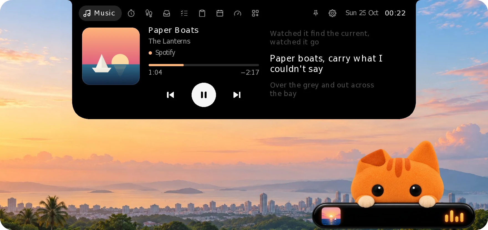</p>

<p align="center"><sub>Free and open source &nbsp;·&nbsp; Windows 10 and 11 &nbsp;·&nbsp; macOS 14 or later &nbsp;·&nbsp; No account needed</sub></p>

<p align="center"><sub>Called Oyen Poni until 0.2.0. Same app with a new name: updating keeps your settings and data.</sub></p>

## Features

### Music, word by word

Controls for whatever is playing: Spotify, Apple Music, YouTube in your browser, or any app in Windows' media controls. The lyrics scroll in time with the song, and Korean, Japanese and Chinese lines get their reading underneath, the way Apple Music shows pronunciation. The line being sung also shows on the closed island, in every theme, with its reading in Latin letters under it, so you can sing along without opening it. Drag the bar to jump anywhere in a song.

<p align="center">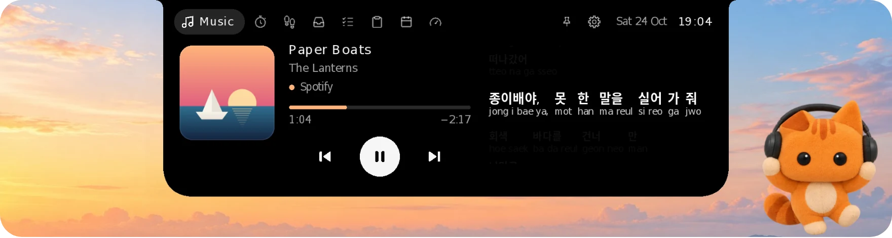</p>

Lyrics come free from [LRCLIB](https://lrclib.net), or from Apple Music itself with [your Apple Music token](#apple-music-lyrics).

### What's happening, at a glance

While it rests, the island is a small black pill that tells you what's going on, then gets out of the way: album art, the line being sung and a beat while music plays, your focus timer, volume and charging, headphones connecting with their battery, money coming in, your daily step goal, the next prayer.

<p align="center">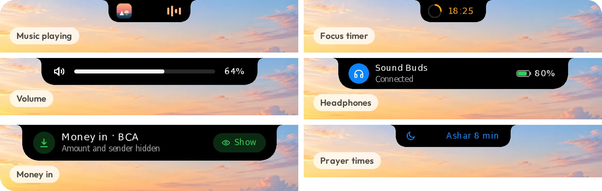</p>

### From your phone to your PC, no app needed

Open the Shelf, scan the code with your phone's camera, pick photos or files and tap **Send**. The island asks first, then they land on the Shelf. It works with iPhones and Android phones over your own Wi-Fi, and a phone you pair once can send from any network.

<p align="center">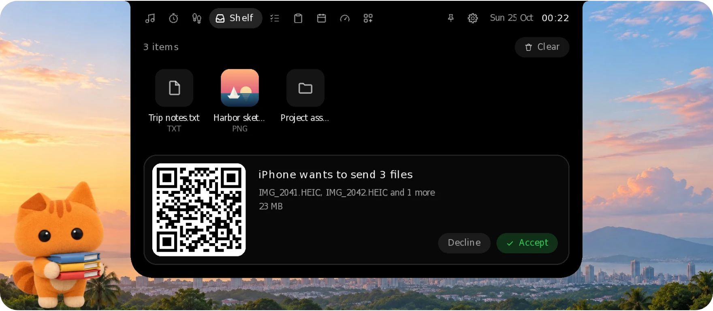</p>

[How Phone drop works](#phone-drop) &nbsp;·&nbsp; [Paired phones](#paired-phones-send-from-any-network)

### FPS, GPU and CPU over your games

**New in 0.1.18.** Switch on **Show over games** and, while a borderless full-screen game is in front, the island becomes a small readout: frames per second, the GPU's load and temperature and the CPU's load. It reads Windows' own log of each frame, the way PresentMon and Xbox Game Bar count them, so nothing is loaded into the game.

<p align="center">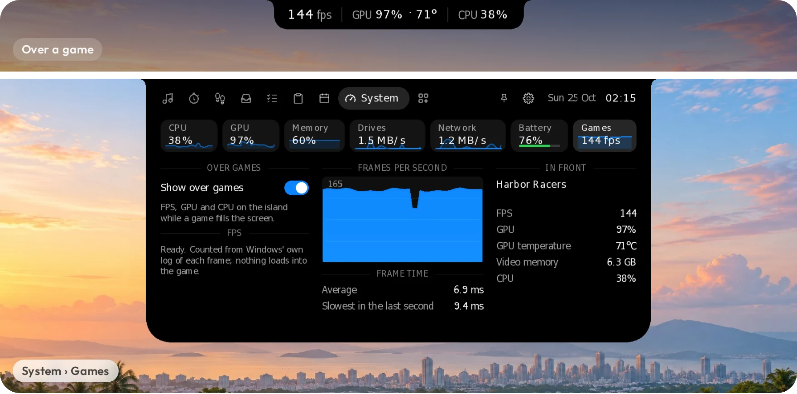</p>

[More on Show over games](#show-over-games)

### Your whole computer on one page

CPU, GPU, memory, drives, network and battery: rings and gauges, each core's load, the last minute of history and the apps using the most. Read straight from Windows' own counters, with no drivers and no admin rights, and it never leaves your PC. On a Mac it reads macOS's own counters, the way Stats does. **System** is an [add-on](#add-ons): its tab shows once you switch it on, and until then nothing reads the counters.

On a desktop, **Power** shows what the whole PC draws: split into the CPU, the graphics card and the rest. A Corsair HXi or RMi, or an MSI MEG Ai or MPG Ai…TS power supply reports the real number over its USB cable, with what it pulls from the wall, its efficiency and its temperature; Oyenza Studio only reads it, while the page is open. With any other power supply, the page estimates: the CPU's own reading, the graphics card's (NVIDIA cards report theirs through the driver), and about 40 W for the board, memory, drives and fans. On a Mac without a battery (a Mac mini, Studio, iMac or Mac Pro with Apple silicon), Power reads what the whole Mac draws from its own sensor, the number Stats shows as System total; macOS doesn't split it by part, so the CPU's and the graphics' load stand beside it. A MacBook keeps its Battery module.

<p align="center">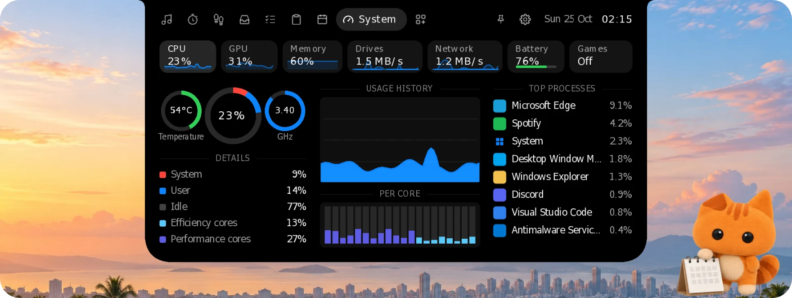</p>

### The small things, one hover away

**Focus** is a Pomodoro timer that keeps counting in the island. **Tasks** is a tiny to-do list. **Today** has the date and the next five weeks, and once you [sign in to Oyenza](#oyenza-optional), your schedule: the meeting on now with **Join**, the rest of today, then the weeks ahead from Google Calendar, with your flights from Gmail and the bills due. Click a date to start the list there. **Shelf** keeps the files you drop on the island. The tabs run Music, Today, Shelf, Tasks, Focus, then Oyenza, with Oyen himself as its tab; Health and System are [add-ons](#add-ons). Scroll over the top of the island to switch pages.

<p align="center">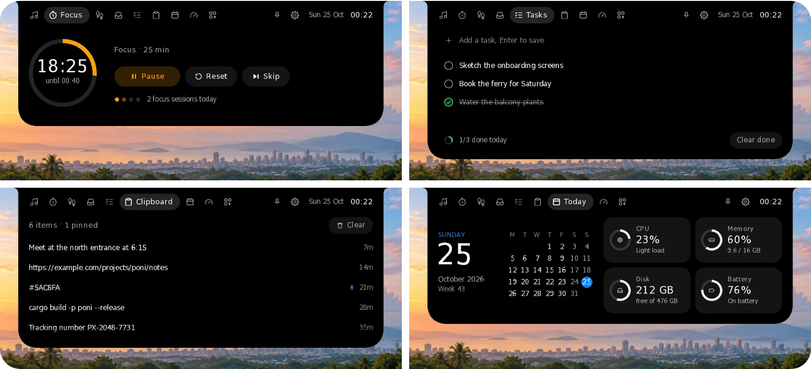</p>

### Black, Oyen, Glass or Pill

The island is black by default, like the one on a phone. **Oyen** turns it warm cream, and Oyen the cat moves in: he peeks over the edge, follows your pointer and sleeps from midnight to five. **Glass** bends and frosts whatever is behind it, after Apple's Liquid Glass; on a Mac it's macOS's own glass. **Pill**, new in 0.1.21, changes the shape: the island floats just below the top of the screen as a black capsule, with the time and battery at rest, the song and the line being sung while music plays, and a rounded card when it opens.

<p align="center">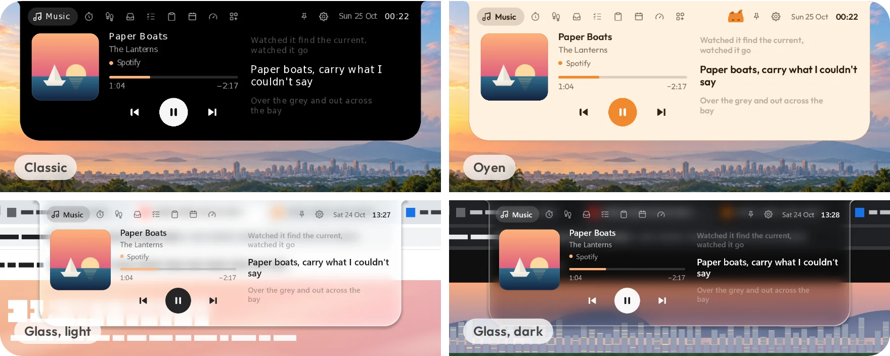</p>

[The Oyen theme](#the-oyen-theme) &nbsp;·&nbsp; [The Glass theme](#the-glass-theme) &nbsp;·&nbsp; [The Pill theme](#the-pill-theme)

### Your money, as it moves

If you keep your money in [Oyenza](https://oyenza.app), sign in (optional) and the island tells you when money comes in or goes out, reminds you the day before a bill is due, and lists your week by day. Sums stay hidden until you click **Show**, so a shared screen shows only that much. Turn on **Show on Oyenza Studio** under your steps in Oyenza's Health (Sehat) on your phone and switch on the **Health** [add-on](#add-ons), and its page shows your daily steps too, with a notice when you reach your goal. On Windows.

<p align="center">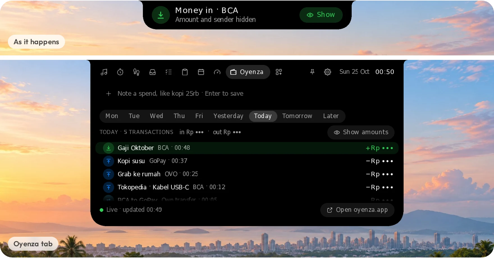</p>

[How signing in works](#oyenza-optional)

### Prayer times for your city

Today's times for your kab/kota as Kemenag RI publishes them, or for your city anywhere else in the world, a countdown in the ten minutes before each prayer, the adzan recorded at Masjidil Haram, and the qibla. It's an add-on: 1.9 MB, downloaded only when you switch it on. On Windows and Mac.

<p align="center">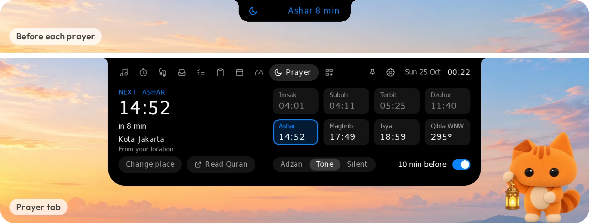</p>

[Add-ons](#add-ons)

### On a Mac, it wraps the notch

On a MacBook, the island lives around the camera notch: the album art on one side, the beat on the other, and it opens downward when you point at it. Whatever plays, with lyrics: Music, Spotify, YouTube and Spotify in your browser, any player that macOS's own now playing shows; the focus timer, the Shelf and Phone drop, tasks, Today and the System add-on are all there, in the Classic, Oyen, Glass or Pill theme.

<p align="center">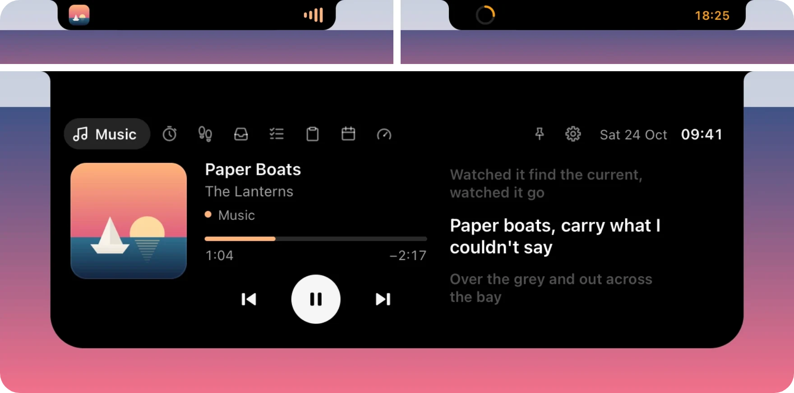</p>

[What's on the Mac so far](#on-a-mac)

## Light by design

<table>
<tr>
<td align="center" width="25%"><h3>2.4 MB</h3>download on Windows</td>
<td align="center" width="25%"><h3>Rust</h3>native code, no web view, no runtime</td>
<td align="center" width="25%"><h3>60–240 Hz</h3>drawn on the GPU, in step with your screen</td>
<td align="center" width="25%"><h3>0</h3>accounts, ads or analytics</td>
</tr>
</table>

On Windows it draws on your graphics card in step with your display's refresh rate (60, 144 or 240 Hz), and draws nothing while nothing moves. Features you don't use don't run: Show over games counts only while a game is in front, and add-ons download only when you switch them on. With the System add-on on, its page keeps its last minute of history with a light reading once a second. It rests while your PC is locked, the screen is off or battery saver is on, and starts a fresh minute when you're back; right-click › **Keep System page history** turns it off.

## Your data stays on your computer

- **No account, no tracking.** Tasks, the Shelf and focus history are files in your own user folder. There are no ads and no analytics.
- **Your files stay yours.** Phone drop asks before it takes anything and uses your own Wi-Fi. Files from paired phones are encrypted with keys made on the two devices, and the meeting server never sees them.
- **Little goes online.** Lyrics lookups go to LRCLIB while a song plays, and once an hour the app reads one small file to see whether a new version is out. Apple Music lyrics, Oyenza, paired phones and add-ons connect only after you turn them on. [PRIVACY.md](PRIVACY.md) lists every request.

## Install


### Windows

**[Download Oyenza-Studio-Setup.exe](https://github.com/lucacadalora/oyenza-studio/releases/latest/download/Oyenza-Studio-Setup.exe)** and run it. It installs just for you and needs no admin rights. Older versions and a portable zip are on the [Releases](https://github.com/lucacadalora/oyenza-studio/releases) page.

Builds aren't code-signed yet, so Windows SmartScreen may say "Windows protected your PC". Click **More info → Run anyway**.

Your data lives in `%APPDATA%\Poni\`, and cache plus log in `%LOCALAPPDATA%\Poni\`. Uninstalling removes the app, cache and log, and keeps your data.

### Mac

macOS 14 or later, Apple silicon or Intel (one app for both): **[download Oyenza-Studio-Mac.dmg](https://github.com/lucacadalora/oyenza-studio/releases/latest/download/Oyenza-Studio-Mac.dmg)**, open it and drag Oyenza Studio into Applications (had Oyen Poni? Quit it first; Oyenza Studio moves the old app to the Trash). It isn't signed with an Apple Developer ID yet, so the first time macOS warns you, click **Done**, then open **System Settings → Privacy & Security** and click **Open Anyway**. What's on the Mac so far: [On a Mac](#on-a-mac). Your data lives in `~/Library/Application Support/Poni/`, the log in `~/Library/Logs/Poni/`.

## FAQ

<details>
<summary><b>Is it free?</b></summary>
<br>

Yes. Oyenza Studio is free to download and use, and its code is open source under the [MIT license](LICENSE). Oyenza sign-in is optional.

</details>

<details>
<summary><b>Will it slow my computer down?</b></summary>
<br>

It's built not to. It's native code with no web view, it draws nothing while nothing moves, and its features sleep until you use them. See [Light by design](#light-by-design).

</details>

<details>
<summary><b>Why does Windows say "Windows protected your PC"?</b></summary>
<br>

The builds aren't code-signed yet, so Windows SmartScreen doesn't know them. Click **More info → Run anyway**. On a Mac, the first launch needs **Open Anyway** in Privacy & Security for the same reason.

</details>

<details>
<summary><b>Does it work on Windows 10?</b></summary>
<br>

Yes, on Windows 10 and 11. Glass needs Windows 10 version 2004 or later to bend what's behind it; before that it draws smoked glass.

</details>

<details>
<summary><b>What's different on a Mac?</b></summary>
<br>

The island wraps the notch, and the Mac has music with lyrics, Focus, the Shelf with Phone drop, Tasks, Today, the System add-on, Prayer times, the Classic, Oyen, Glass and Pill themes, headphone pop-ups, hiding in full-screen apps, Oyenza sign-in and start at login. Not on the Mac yet: paired phones and Show over games. [On a Mac](#on-a-mac) has the details.

</details>

<details>
<summary><b>Can it hide during games and videos?</b></summary>
<br>

Yes: right-click the island › **In full-screen apps** › **Hide**. Pick **Stay on top** instead to keep it over borderless games and videos, or turn on [Show over games](#show-over-games) for a frame rate readout. On a Mac the same choice is in the menu bar under Oyen's mark (and in Settings): with **Hide**, macOS keeps the island off a full-screen app's Space until you leave it.

</details>

<details>
<summary><b>Does it cover my browser tabs?</b></summary>
<br>

It sits over the middle of the top edge, so over a maximized browser it can cover the tabs there. To keep that spot clear, right-click the island › **Idle look** › **Hidden until hover**: while nothing plays, only an invisible strip stays at the top edge until you point at it.

</details>

<details>
<summary><b>Where are my files and settings?</b></summary>
<br>

On Windows in `%APPDATA%\Poni\` (cache and log in `%LOCALAPPDATA%\Poni\`); on a Mac in `~/Library/Application Support/Poni/` (log in `~/Library/Logs/Poni/`). Uninstalling keeps your data.

</details>

## Guides

The details behind each feature.

### Settings and options

The gear at the top right of the open island opens **Settings**: your Oyenza account first, then the theme, the idle look and the switches below. Right-click the island or the tray icon for every option:
- the theme: Classic, Oyen, Glass or Pill
- the idle look: clock, eyes (Oyen in his theme), minimal, hidden until you hover, or a status bar (in Pill; the other themes show the clock)
- lyrics (and the pronunciation line under Japanese, Korean and Chinese lyrics) and sounds
- in full-screen apps: hide, or stay on top of borderless games and videos (a game in exclusive full-screen mode still covers it), and show FPS, GPU and CPU over games
- start with Windows, which version you have (**About Oyenza Studio**, with the build's day; it opens that version's release notes), and quit
- in Settings only: which version you have, with **Check now** ([New versions](#new-versions))

On a Mac, every option is in the menu bar, under Oyen's mark.

### The Oyen theme

The island stays black by default. Switch on the Oyen theme (the gear › **Theme › Oyen**, or right-click › **Theme › Oyen**) and the whole island becomes Oyen's: warm cream with dark brown text, his orange on the play button, the bars and the switches, and Outfit, the Oyenza Studio typeface. Oyen, the Oyenza cat, moves in too: he peeks over the island's edge while it rests, watches your pointer when it comes near, sits beside the clock, peeks up beside the pin when the island is open and bobs along while music plays. He sleeps from midnight to five. Where the island wraps a MacBook's notch, the theme goes black like the notch itself, with Oyen's cream type, his orange and his face on it. He is drawn from the Oyenza logo, not a picture, so he stays sharp at any scaling, and he only moves for a moment now and then, so he costs no CPU at rest.

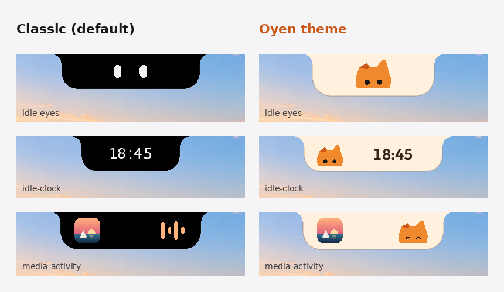

### The Glass theme

Glass turns the island into liquid glass, after Apple's Liquid Glass. Its rim bends and magnifies what's under it, the middle is frosted, a light runs along the edge, and the shadow under it deepens over busy pages. The collapsed island turns light or dark with what's behind it, and the open island follows Windows' light or dark mode. Its tint goes only as deep as the text needs to stay readable (4.5:1).

To bend what's under it, Glass copies the part of the screen behind its window (the island and the space it opens into) whenever something there changes, and not while the island is hidden, a full-screen app is in front (there it draws smoked glass, so a game's frames aren't copied) or the PC is locked. The copy stays in your PC's memory and on its graphics card, and each new copy replaces the last; it's never saved or sent. While Glass is on, Windows leaves Oyenza Studio out of screenshots, screen recordings and screen sharing. On a display in HDR, Oyenza Studio maps the copy back to ordinary colours itself. Where it can't copy the screen (the software renderer, Windows 10 before version 2004, Remote Desktop, a laptop display that no graphics card lets it copy), Glass draws smoked glass instead: the same shape, light and shadow over a see-through tint, and it stays in screenshots.

On a Mac, Glass is macOS's own glass: Liquid Glass on macOS 26, and a dark blur on macOS 14 and 15. It's the dark kind, so white text stays readable over any wallpaper, and where the island meets the notch it keeps a black strip that fades into the glass. macOS draws the glass itself, so Oyenza Studio doesn't copy your screen for it. If Glass looks flat, turn off **Reduce transparency** in System Settings › Accessibility › Display.

### The Pill theme

Pill changes the island's shape and layouts, not only its colours. Pick it with right-click › **Theme › Pill**, or the gear › **Theme › Pill**; on a Mac, in the menu bar's Theme menu.

- **It floats.** The island sits a little below the top edge: a capsule while it rests, and a card with all four corners rounded when it opens. A soft shadow and a fine rim keep it apart from the wallpaper, light or dark.
- **At rest** it shows the time and, on a laptop, the battery's percentage and the battery on the right, with a bolt while it's plugged in. A desktop shows the time alone. Pick **Idle look › Status bar** and it widens into a status bar: the volume, the date and time in an inner pill, and the battery. Status bar is Pill's own; the other themes keep the clock.
- **While music plays** it shows the album art, the line being sung (or the title and artist between lines) and bars in the album's colour, with a glow of it along the bottom edge.
- **Open**, it's a card with Classic's tabs. The Music page lays out like a player card: the art, the player's name over the song, the time on one line and big controls, with the lyrics beside them. Pop-ups, notices and the focus timer take the capsule shape too.
- **Colour only where it means something:** the album's colour for music, green for a charging battery, red for a low one, and your Windows accent elsewhere.
- **On a MacBook with a notch**, Pill is either the pill or the notch: at rest it goes back into the notch (the menu bar already shows the time and the battery; the Eyes look still peeks out beside the camera), and music, from the first note to the end of a pause, the timer, pop-ups, notices and the open card float just below the notch. Without a notch it floats below the top of the screen, as on Windows.

The pages and features are the same as in Classic.

### Show over games

Switch on **Show over games** (System › Games, or right-click › In full-screen apps) and, while a game fills the screen in borderless full-screen, the island becomes a small readout: frames per second, the GPU's load and temperature and the CPU's load. It stays for as long as the game is in front; **Alt+Shift+F** hides it until the next game, and pressing it again brings it back. Any window over a borderless game, the island included, makes Windows combine the two before they reach the screen, which costs the game about a frame of delay. If you'd rather not pay it, pick **Readout › Peeks** in System › Games (or right-click › In full-screen apps › Only for a few seconds): the readout then shows for a few seconds when the game comes to the front, when the frame rate drops sharply and whenever you press Alt+Shift+F, then hides, and in between the game's frames go straight to the screen. Turning it on also lets the island show over full-screen apps; picking Hide there turns it off again. Alt+Shift+F belongs to Oyenza Studio only while a game is in front.

The frame rate is counted the way Intel's PresentMon and Xbox Game Bar count it: Windows logs every frame a game hands to the screen, and Oyenza Studio reads that log for the game in front. Nothing is loaded into the game, so there is nothing for anti-cheat to see. DirectX 9 to 12 games are counted from their own Present calls; Vulkan and OpenGL games from the graphics kernel's log of their frames. The GPU and CPU numbers come from the same readers as the System page. Nothing runs while no game is in front or while the readout is off.

Windows lets only admins and the **Performance Log Users** group read that log. The first time, System › Games asks for a one-time OK: an admin prompt adds your Windows account to that group (Xbox Game Bar's FPS counter asks for the same), and Windows applies it the next time you sign in. Until then the FPS slot shows a dash and the rest works. To undo it, remove your account from Performance Log Users in Computer Management, or run `net localgroup "Performance Log Users" <your user name> /delete` as an admin. A game in exclusive full-screen mode still covers the island, as it covers every window.

### On a Mac

On a MacBook with a camera notch, the island lives around it: what's playing sits either side of the camera (the album art on the left and the beat on the right, a timer's ring and its minutes the same way), and the island opens downward from the notch when you point at it. On a Mac without a notch, or on another display, it hangs from the top of the screen as it does on Windows. Around the notch, the Oyen theme goes black like the notch itself, with Oyen's cream type, his orange and his face on it. Pick the eyes as the idle look and they play hide and seek with the camera: they peek out beside it on your pointer's side and follow your pointer anywhere on the screen, and when it crosses over they duck behind the camera and come out on the other side. Oyen does the same in his theme.

The Mac app has the island, whatever plays with synced lyrics (Music, Spotify, a browser's YouTube or Spotify tab, any player in macOS's own now playing, read through the open-source MediaRemote adapter; Apple Music's own lyrics with [your token](#apple-music-lyrics)), the focus timer, the Shelf with [Phone drop](#phone-drop) over the same Wi-Fi, tasks, Today with your Mac's CPU, memory, disk and battery, the System add-on with your Mac's CPU, graphics, memory, drives, network, battery and busiest apps, pop-ups for volume, charging and Bluetooth headphones (without the battery level; macOS shows AirPods' own when they connect), [Prayer times](#add-ons) (Location Services finds your city, or you type it), the Classic, Oyen, Glass and Pill themes ([Pill](#the-pill-theme) floats just below the notch for music, pop-ups and the open card, and rests inside it), hiding in full-screen apps (or staying on top of them), [Oyenza sign-in](#oyenza-optional) and start at login. Every option is in the menu bar, under Oyen's mark. Not on the Mac yet: paired phones and Show over games.

The Mac pictures come from the Mac app itself (`poni --render <dir> --notch`, run by the `mac` workflow on a macOS runner with a MacBook's notch drawn in).

### Apple Music lyrics

Lyrics come from LRCLIB by default. With an Apple Music subscription, Oyenza Studio can show Apple Music's own synced lyrics instead: the ones the Apple Music app shows. This works whichever app is playing. LRCLIB stays the backup for songs Apple has no synced lyrics for.

It needs your Apple Music token, copied once from the web player:

1. Open [music.apple.com](https://music.apple.com) in Chrome or Edge and sign in.
2. Press F12, open **Application** → **Cookies** → `https://music.apple.com`, and copy the value of `media-user-token`.
3. Right-click the island (or the tray icon) → **Apple Music lyrics** → **Use token from clipboard**.

Oyenza Studio checks the token with Apple and says whether it worked. It stores the token encrypted for your Windows account (`%LOCALAPPDATA%\Poni\apple-music-token.bin`) and clears it from the clipboard. If Windows clipboard history (Win+V) is on, delete it there too. A token lasts for months; when Apple stops accepting it, Oyenza Studio says so and you copy a fresh one. **Remove token** in the same menu turns this off.

With a token saved, Oyenza Studio sends each song's title and artist to Apple to find its lyrics. It uses the Apple Music web player's own API, which Apple doesn't publish for other apps, so it can stop working when Apple changes its site. LRCLIB keeps working either way.

### Phone drop

Send photos and files from your phone to the Shelf, or save Shelf files on your phone, over your own Wi-Fi. Nothing to install on the phone, and it works with iPhones and Android phones alike.

1. Open the Shelf and click **Phone** (on an empty shelf, the **Phone drop** tile). A QR code opens under the shelf.
2. Scan it with the phone's camera. The phone opens a small page that Oyenza Studio serves from your PC.
3. Pick photos or files on the phone and tap **Send**. The island asks first: **Accept** or **Decline**. Accepted files go to `Downloads\Oyenza Studio` and onto the Shelf.
4. The page also lists the files on the Shelf. Tap **Save** to keep one on the phone.

| | |
|---|---|
| 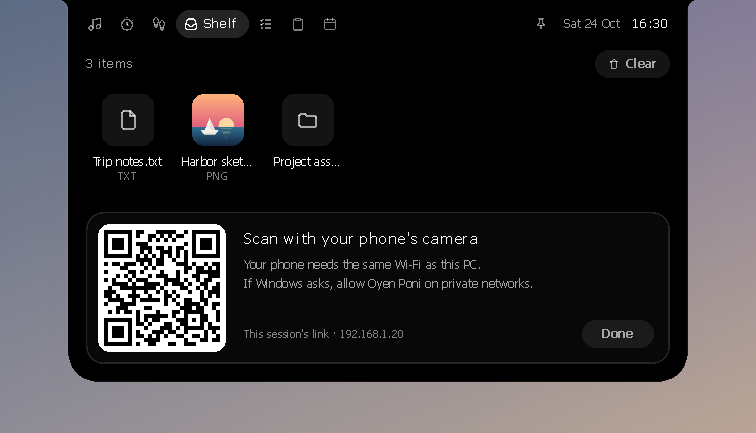 | 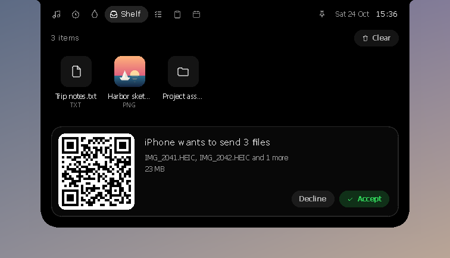 |

The phone and the PC need the same Wi-Fi; guest networks often keep devices apart. The first time, Windows asks whether Oyenza Studio may use the network: allow it on private networks. If Windows treats your Wi-Fi as a public network, set it to private (Settings > Network & internet > Wi-Fi), or the phone can't reach the PC.

Each session gets a new secret link that only the QR code carries. It stops working when you click **Done**, and after 10 minutes without a phone. Oyenza Studio reads nothing from an upload before you accept, keeps a transfer only when every file arrived, and never sends anything through the internet. Files travel over your Wi-Fi without extra encryption on top of the Wi-Fi's own, so use Phone drop on networks you trust rather than public hotspots.

This isn't AirDrop. An iPhone only AirDrops over Apple's own Wi-Fi link (AWDL), which Windows Wi-Fi drivers can't run, so Phone drop uses the phone's browser instead.

#### Paired phones: send from any network

Pair a phone once, and it finds this PC from any network, whenever Oyenza Studio runs: the same Wi-Fi, another Wi-Fi or mobile data.

1. In the phone panel, click **Pair a phone** and scan the new code. The phone opens `drop.oyenza.com` and says it's paired.
2. Keep that page: on an iPhone, tap Share › **Add to Home Screen**; on Android, install it (Chrome or Samsung Internet). Android then lists **Oyenza Studio** in the share sheet.
3. Send from the share sheet or from the page. Files from your own paired phones go straight onto the Shelf, with a notice on the island.

| | |
|---|---|
| 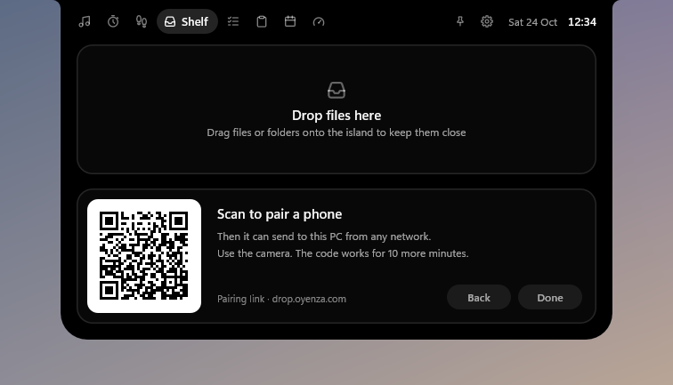 | 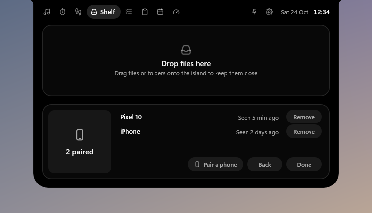 |

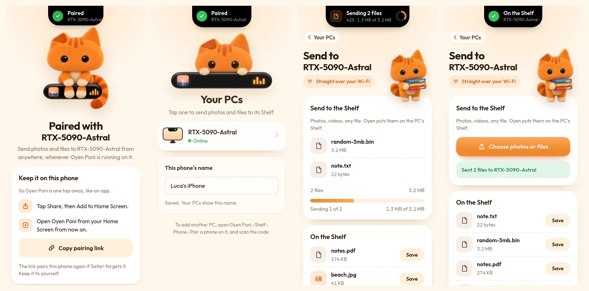

The phone and PC meet through a small server (`drop.oyenza.com`, code in [`server/`](server)); the files go straight between them over WebRTC, encrypted with keys made on the two devices, or through a relay that can't read them when both networks block a direct link. The server never sees a file, a file name, or the pairing secret: every message is signed with that secret, which only the QR code carries. **Paired phones** lists each phone with **Remove**. How it works: [docs/paired-drop.md](docs/paired-drop.md).

### Oyenza (optional)

If you keep your money in [Oyenza](https://oyenza.app), the island can show it. Signing in is optional and works like a TV: no password is typed into Oyenza Studio.

1. Open the island, press the gear at the top right, and choose **Sign in with Oyenza** (the Oyenza tab has the same button; right-click the island or the tray icon → **Oyenza** → **Sign in to Oyenza…** works too; on a Mac, the menu bar under Oyen's mark). The island shows an 8-letter code.
2. Open oyenza.app/connect on your phone or this computer (**Open oyenza.app** fills the code in), check the computer's name, and choose **Connect**.

Then the island shows:

- **Your Oyenza, live, by day**: the **Oyenza** tab lists every transaction of the last 7 days, newest first, with each day's money in and out: pick Sun to Thu, Yesterday or Today on the strip of days. Something logged while you look glows for a minute. **Tomorrow** and **Later** list the subscriptions and card bills due in the next five weeks.
- **Money in and out as it happens**: a notice when Oyenza logs money by itself from your bank's emails or notifications, "Money in · BCA" or "Money out · BCA". Sums and who stay hidden until you click **Show**, there and in the tab, so a shared screen shows only that much.
- **Bills before they're due**: a reminder the day before a subscription renews or a card bill is due.
- **Note a spend**: type it in the **Oyenza** tab ("kopi 25rb") and press Enter; it goes straight to Oyenza, with Undo for 10 seconds.
- **Your weeks on Today**: in oyenza.app, under Connected apps › Oyenza Studio, switch on **Google Calendar** or **Gmail**, and the **Today** tab shows the meeting on now (with **Join** for a Google Meet, Zoom, Teams or Webex link), the rest of today, then the next five weeks: your events (click one to open it in Google Calendar), the flights Oyenza found in your booking emails and the bills due, with a dot under each date in the grid for what's on it. An app switched off for Studio says so, with **Turn on**. Signed out, Today offers **Sign in with Oyenza**.
- **Your steps**: in Oyenza on your iPhone or Android, turn on **Show on Oyenza Studio** under your steps in Health (Sehat), switch on **Health** in Add-ons, and its tab shows today's steps against your goal, the distance, active energy and your week, with a notice when you reach the goal. Oyenza on the phone sends them while it's open there; numbers more than a day old stay, with a reminder to open Oyenza on your phone.

This PC gets a key of its own that can do only these things: it reads the last 7 days of transactions in the space where Oyenza logs your bank's emails and notifications, never balances, account numbers, notes or receipts, and it can't change or delete anything else or touch your account. With **Show on Oyenza Studio** on, it also receives the daily totals of steps, distance and active energy for the last 7 days and your step goal, and keeps them in memory only, never on disk; sleep, heart rate and weight never reach the PC. With Google Calendar or Gmail switched on for Today, it receives the events of today and the next five weeks (title, times, place, one meeting link and the event's own Google Calendar link) and the flights in those weeks, also in memory only; guests, event notes and your emails never reach it. The key is stored encrypted for your Windows account (`%LOCALAPPDATA%\Poni\oyenza-link.bin`); on a Mac, in a file only your Mac account can read (`~/Library/Application Support/Poni/oyenza-link.bin`). Oyenza Studio asks Oyenza once a minute while you use the PC (every 3 minutes on battery, never while it's locked or asleep), every 15 seconds while the Oyenza tab is open, for your steps every 15 minutes and when the Health tab opens (only while the Health add-on is on), and for your day when the Today tab opens and every 5 minutes while it stays open. **Disconnect** in Settings (or **Oyenza › Disconnect** in the menu) signs this PC out; you can also disconnect it in oyenza.app under Connected apps.

### New versions

Oyenza Studio looks for a new version a couple of minutes after it starts and then every hour, by reading one small signed file from studio.oyenza.com. It doesn't look while your PC is locked, the screen is off or battery saver is on. **Check for updates…** in the menu looks right away and says on the island what it found; **Check now** in Settings does the same and answers there. When there is a new version, the island says **Update available** with the version and keeps saying it until you click it or **Hide** it. The new version is already downloaded by then, and checked: click the notice for the Update sheet, then **Install now** (Oyenza Studio closes, updates and opens again in a few seconds, your settings and data stay) or **Install on next start**. On a Mac this works where Oyenza Studio can replace itself, as in Applications; opened straight from the DMG, its sheet downloads the DMG instead. Until you update, the right-click menu starts with **Update to Oyenza Studio x…** and Settings has a last row with **Update**. After you update, the island says **Updated to x** once, with **What's new**. Versions 0.2.5 and older don't look: update them by hand once. How the file is made and signed: [docs/updates.md](docs/updates.md).

### Add-ons

The **+** at the end of the tabs lists features that stay off until you switch them on. Most aren't part of the download: switching one on downloads its files from this project's releases (each checked against the size and SHA-256 built into the app), and switching it off deletes them. While every add-on is off, nothing is downloaded and nothing of theirs runs.

**Prayer times** (1.9 MB) shows today's times for your kab/kota as Kemenag RI publishes them, with Imsak and Terbit, the next prayer and how long until it, and the qibla. Makkah, Madinah and Jeddah use Umm al-Qura. Outside Indonesia, any of 33,000 cities (every one of 15,000 people or more, looked up online as you type, so the add-on doesn't carry them) gets the times of the method its country follows, named beside the place: the Moonsighting Committee in the UK, the US and Canada, Umm al-Qura on the Arabian Peninsula, Dubai, Qatar, Kuwait, Singapore's for Singapore, Malaysia and Brunei, Diyanet in Turkey, Tehran in Iran, Karachi in South Asia (Hanafi Ashar there and in Central Asia), the Egyptian authority in Africa, Syria and Lebanon, and the Muslim World League everywhere else, on the city's own clock, summer time included. In the 10 minutes before each prayer the island counts down, and at the time it says so with a short tone, the adzan recorded at Masjidil Haram, or nothing (Subuh gets the tone). Music pauses for the adzan; **Stop** ends it.

- **Your place:** Windows' location (Location Services on a Mac) picks the nearest of Kemenag's 517 places or of the world's cities, and checks again every few hours, so a trip moves the place. Away from Kemenag's places, the cities of the 5-degree squares around you come from studio.oyenza.com; the point itself is used on your computer and never saved or sent. Only the place picked is saved, with its clock, so its times need nothing online. With location off, the computer's time zone suggests a place; **Change place** lets you type yours: a kab/kota, or any city.
- **Accuracy:** replayed against Kemenag's published 2026 schedule for all 517 places, 98.2% of 227,367 times match to the minute and none is more than a minute off. Outside Indonesia the times are [Adhan](https://github.com/batoulapps/adhan-js)'s own, checked to the minute against adhan-js on 47 cities over two years; near the poles, on days without a sunrise, a sunset or room for Ashar, they come from the nearest latitude that has them (`cargo test -p poni-core prayer`; details in [addons/sholat](addons/sholat/README.md)).

**Japanese readings** (3.8 MB) gives romaji under the kanji in Japanese lyrics on PCs where Windows can't read them (Windows keeps its Japanese reading data in the Japanese typing feature, which most PCs outside Japan don't have). Only people who play Japanese songs get it: the first time a song's kanji go unread, it switches itself on and downloads once, and the romaji show a moment later. Switch it off in Add-ons and it stays off; the Music page then offers it under the lyrics, one click away. Kana, Korean and Chinese read without it. On a Mac it gives romaji under every kanji the same way, and the Mac's Add-ons tab switches it too. Details in [addons/ja](addons/ja/README.md).

**Health** (built in, nothing to download) adds the **Health** tab: your steps from Oyenza on your phone, today against your goal and your week ([how to send them](#oyenza-optional)). It was a tab for everyone until 0.2.8. Switched off, there's no tab and Oyenza Studio never asks Oyenza for your steps.

**System** (built in, nothing to download) adds the **System** tab: [your whole computer on one page](#your-whole-computer-on-one-page). It was a tab for everyone until 0.2.8 and is now off until you switch it on. Switched off, there's no tab and nothing reads the counters at rest; Show over games keeps its own switch.

**Stocks** (built in, nothing to download) adds a **Stocks** tab, laid out like Apple's Stocks on a Mac: the IHSG and up to 10 stocks on the Indonesia Stock Exchange, each with its day's line against the previous close, its price and a change pill (click any pill to switch them all between percent, points and market cap). The one you pick fills the right side: its chart over 1D, 1M, 6M or 1Y (point at the chart to read any moment), and the day's open, high and low, volume, value traded, market cap and 52-week high and low. **Add a stock** searches every listed stock by code or name; **Edit** removes and reorders them. Prices come from [oyenza.trade](https://oyenza.trade), 10 minutes behind the exchange like every free IDX feed, and are asked for only while the tab is open. Switched off, there's no tab and nothing is asked.

**Script reader** (built in, nothing to download) adds a **Script** tab: a teleprompter right under your webcam. Paste a script or drop a `.txt` file on the island and press **Read**. The line to say stays bright with the next ones dim below, moving a line at a time at 60 to 300 words a minute. Space pauses, the arrow keys step a line or change the pace, and on Windows **Alt+Shift+S** pauses or resumes from any app. On Windows the island stays out of screen shares and recordings while the page shows; macOS no longer lets an app keep itself out of captures, so on a Mac it shows in full-screen shares. Switched off, there's no tab, no shortcut and nothing running.

**Screen recorder** (built in, nothing to download) adds a **Record** tab once [Oyenza Studio Recorder](https://studio.oyenza.com/) is installed: the island becomes the recorder's face, so the recorder shows no floating bar of its own. Pick **Screen** (the screen the island is on), **Window** or **Area** (the recorder's overlay asks for the window or the area), switch the **Camera**, **Mic** and **Sound** on or off, and press **Record**. While it records, the closed island shows the red dot and the time ahead of everything else; open it for **Pause** and **Stop**, which saves the video and opens the recorder's editor. The island stays out of the video. It switches itself on with the recorder (switch it off in Add-ons to get the recorder's own bar back) and is Windows-only for now.

## Build

Oyenza Studio is a Cargo workspace:

| Crate | What |
|---|---|
| `crates/poni-core` | Pure logic (springs, lyrics parsing, Pomodoro, steps, tasks, settings…), Phone drop's small web server and paired phone drop (pairing, signed messages, the WebRTC link). Unit-tested on any OS. |
| `server` | The meeting server and phone page for paired phones (`drop.oyenza.com`); Node, no dependencies. |
| `crates/poni` | The app. On Windows: Win32 + Direct2D + WinRT through [windows-rs](https://github.com/microsoft/windows-rs). On a Mac (`src/mac/`): AppKit, Core Graphics and Core Text through [objc2](https://github.com/madsmtm/objc2), drawing the same pages. |

On Windows, with Rust stable and the MSVC toolchain:

```
cargo test -p poni-core
cargo build -p poni --release        # target\release\poni.exe
```

To cross-build from macOS or Linux, install `mingw-w64` and add the target (`rustup target add x86_64-pc-windows-gnu`):

```
cargo wcheck                          # type-check the Windows app
cargo wbuild                          # target/x86_64-pc-windows-gnu/release/poni.exe
NSIS_HOST=user@linux-box tools/package.sh   # exe + portable zip + installer into dist/
```

On a Mac, with Rust stable:

```
cargo build -p poni --release        # target/release/poni
target/release/poni --render shots --notch   # every island state as a picture, with a MacBook's notch
```

`tools/make_mac_app.sh` turns the Apple silicon and Intel builds into `Oyenza Studio.app` and its DMG (the `mac` workflow does it for every pull request, push to main and tag). From Linux or Windows, `cargo mcheck` type-checks the Mac app (`rustup target add aarch64-apple-darwin`).

### Testing without clicking around

`poni.exe --selftest <dir>` runs a scripted tour of every state with fake data and writes a screenshot of each one, plus `report.json` with layout and timing checks. The exit code is non-zero on failure. On a software rasterizer, such as GitHub's runners, a slow frame is listed in `slow_frames` instead of failing the run, and a scene gets 8 s instead of 3 to settle. It also works under Wine on Linux (`tools/run-selftest-wine.sh`), which is how the pictures in this README were made, so the font is a stand-in for Segoe UI.

| Variable | Effect |
|---|---|
| `PONI_SELFTEST_DPI=144` | Render at 150% scaling (also 120 and 192) |
| `PONI_SELFTEST_ANIM=1` | Also record the transitions frame by frame (plus each frame's screen position in `anim-<name>.json`) |
| `PONI_RENDERER=software` | Draw in software instead of on the GPU (also outside the self-test, for troubleshooting) |


See [ARCHITECTURE.md](ARCHITECTURE.md) for how the pieces fit: threads, the rendering model, the page and service contracts, and data files.

### Website

The website is `site/index.html`, published with GitHub Pages by `.github/workflows/pages.yml` whenever `site/` or `docs/brand/` changes on main. Every release updates it too ([AGENTS.md](AGENTS.md#every-release-updates-the-website) has the checklist). A page that names a version not released yet waits until that release is published, and a release whose page wasn't updated opens an issue. Preview it with `tools/build_site.sh && python3 -m http.server -d _site 8000`. Its island screenshots come from the self-test at 200 % (Classic and Oyen, plus Pill for its own section), and its Mac pictures from the `mac` workflow's renders (`tools/site_shots.py`).

The README's feature pictures are drawn from those same screenshots by `tools/make_readme_art.py` (from `tools/readme_art.html`) into `docs/brand/readme/`. Rerun it after retaking the screenshots.

### Download stats

[The stats page](https://github.com/lucacadalora/oyenza-studio/blob/metrics/README.md) shows downloads per release and per day. Every hour `.github/workflows/metrics.yml` reads GitHub's download counters with `tools/download_metrics.py` and keeps the history on the `metrics` branch. Downloads made by our own CI (the install test fetches the 0.1.1 installer on every push) are left out. The app itself counts nothing.

## Status

Early, but in daily use on Windows 11. The Mac app is newer: it runs on GitHub's macOS runners on every change, and a real MacBook's notch, music apps and drag and drop are where it most needs reports. Most rough edges are in places a test machine can't fully exercise: specific media players, Bluetooth devices, and multi-monitor setups. Issues and pull requests are welcome. Please attach `%LOCALAPPDATA%\Poni\poni.log` (on a Mac, `~/Library/Logs/Poni/poni.log`) when something misbehaves.

## Credits

- Synced lyrics come from [LRCLIB](https://lrclib.net), a free and open lyrics database. Oyenza Studio fetches them only while a song plays and caches them on your PC.
- With your token, lyrics can also come from [Apple Music](https://music.apple.com) (see [Apple Music lyrics](#apple-music-lyrics)).
- Phone drop follows the design of [Windfall](https://github.com/UvejsGj/Windfall)'s phone page (MIT). QR codes come from [qrcodegen](https://github.com/nayuki/QR-Code-generator) (MIT).
- Romaji under Japanese lyrics comes from Windows' own reading analyzer or, on PCs without Windows' Japanese data, from [mecab-ipadic](https://taku910.github.io/mecab/) read with [vibrato](https://github.com/daac-tools/vibrato) (MIT/Apache-2.0).
- Paired phones follow the idea of [PairDrop](https://github.com/schlagmichdoch/PairDrop)'s paired devices (no code taken). The WebRTC link is [str0m](https://github.com/algesten/str0m) (MIT or Apache-2.0).
- Prayer times use the sun's position and calculation methods from [Adhan](https://github.com/batoulapps/adhan-js) (MIT), Kemenag RI's rules, and reference points fitted to Kemenag's published schedule. Cities outside Indonesia come from [GeoNames](https://www.geonames.org) ([CC BY 4.0](https://creativecommons.org/licenses/by/4.0/)), their time zones from the IANA time zone database. The adzan is "Maghrib Adhan at the Masjid al Haram, Mecca - 25 Feb, 2012" by 3omar Faruq, from [Wikimedia Commons](https://commons.wikimedia.org/wiki/File:Maghrib_Adhan_at_the_Masjid_al_Haram,_Mecca_-_25_Feb,_2012.webm), [CC BY 3.0](https://creativecommons.org/licenses/by/3.0/) (cut to the adzan, mono, levelled).
- Built with [windows-rs](https://github.com/microsoft/windows-rs) and [serde](https://serde.rs).

## License

The code is [MIT](LICENSE). The Oyenza Studio name, its logo and the Oyen character (the files in `docs/brand`, `installer/art` and the app icon) are not covered by the MIT license, so please don't reuse them in other projects. The Japanese reading dictionary (`crates/poni-core/data/ja-readings.dic.zst`, the Japanese readings add-on) is derived from mecab-ipadic and keeps its own license, which the add-on's `NOTICE.txt` carries. [THIRD-PARTY-NOTICES.txt](THIRD-PARTY-NOTICES.txt), which ships with every download, holds that license and those of the Unicode data and the Rust crates Oyenza Studio is built from.
